# SemiSwing: Architecture & Implementation Specification

> [!NOTE]
> **Status: Implemented, Validated & Deployed (`2018–2026` Dataset, `2022–2026` Out-of-Sample Walk-Forward, 9:00 AM ET Cloud Pipeline).**
> - **Cloud Dashboard Hub:** [reports/index.html](../reports/index.html)
> - **Daily Trade Ticket & `$` Allocations:** [reports/daily/latest_recommendations.html](../reports/daily/latest_recommendations.html)
> - **Interactive Dynamic Backtest Report:** [reports/backtests/backtest_report.html](../reports/backtests/backtest_report.html)
> - **Markdown Backtest Summary:** [reports/backtests/backtest_report.md](../reports/backtests/backtest_report.md)

A signal, walk-forward backtest, and daily portfolio allocation system for 2–5 week momentum swings in semiconductor/AI leaders (`50` regular stocks across 5 AI ecosystem groups) and unleveraged sector/index ETFs (`SMH`, `SOXX`, `VGT`, `QQQ`, `SPY`, `AIQ`, `IGV`). The system tracks both a **$10,000 walk-forward paper benchmark** and your actual **Roth IRA holdings** ([`config/portfolio.yaml`](../config/portfolio.yaml)) across two cash-management modes:
1. **Cash Swing Mode (`100% Cash` Default):** Unallocated cash accrues daily historical 3-Month Treasury Bill interest (`FRED DTB3`, `cash_rate_apy / 252`).
2. **SMH Bull Core + Swing Mode:** During confirmed secular semiconductor bull regimes (`smh_secular_bull == 1`), unallocated cash is swept into `SMH` core holdings and automatically rotated back into 3-Month T-Bill cash when the secular trend breaks (`smh_secular_bull == 0`).

> [!IMPORTANT]
> All strategy parameters live in [`config/strategy.yaml`](../config/strategy.yaml), portfolio holdings live in [`config/portfolio.yaml`](../config/portfolio.yaml), and models are validated via expanding-window out-of-sample walk-forward evaluation (`2018–2021` warmup, `2022–2026` out-of-sample).

---

## Core Design Decisions

| # | Topic | Decision |
|---|---|---|
| 1 | Portfolio Tracking | Actual Roth IRA holdings synced in [`config/portfolio.yaml`](../config/portfolio.yaml) (from local `/snapshots/` screenshots, gitignored) + `$10,000` walk-forward benchmark. |
| 2 | Data | Free sources (`2018–2026`), stored in DuckDB (`data/semiswing.duckdb`) and cross-validated across `yfinance`, `Stooq`, and `FRED` (§3). |
| 3 | Instruments | **Regular stocks & unleveraged ETFs only** (no options, no leveraged ETFs like `SOXL`/`TQQQ`/`NVDL`). Fractional shares supported. |
| 4 | Cash & Core Sleeve | Uninvested cash earns daily 3M T-Bill yield (`FRED DTB3 / 252`). Optional **SMH Bull Core + Swing** sleeve holds `SMH` during secular bull regimes (`smh_secular_bull == 1`). |
| 5 | Daily Delivery | **Cloudflare Pages Web Dashboard** ([`reports/index.html`](../reports/index.html) & [`reports/daily/latest_recommendations.html`](../reports/daily/latest_recommendations.html)) + inline-styled **HTML Trade Ticket Email** (`Mail.app` / `Resend` / `SMTP`) + `ntfy.sh` / SMS. |
| 6 | Daily Cloud Runtime | **GitHub Actions** ([`.github/workflows/daily_semiswing.yml`](../.github/workflows/daily_semiswing.yml)) runs `semiswing daily-run` at **9:00 AM ET** on NYSE market-open days, updating both the Backtest Report and Daily Trade Ticket and pushing to `main` to trigger **Cloudflare Pages** deployment. |
| 7 | Interactive Reporting | Self-contained Plotly HTML report ([`reports/backtests/backtest_report.html`](../reports/backtests/backtest_report.html)) with dual-handle date range slider, fund filter pills, and live excess-return Sharpe/Sortino recomputation. |

### Optional Environment & API Variables (`.env` locally or GitHub Actions Secrets)

| Variable | Purpose | Where | Required? |
|---|---|---|---|
| `MAIL_SENDER` / `ALERT_EMAIL` | Sender & recipient for HTML Trade Ticket emails (strictly blocks `jhu.edu` / `jh.edu`) | `.env` / GitHub Secrets | Optional (Webpage updates work with zero keys) |
| `RESEND_API_KEY` / `SMTP_*` | Cloud HTML email delivery from GitHub Actions (`Resend` or `SMTP`) | resend.com / GitHub Secrets | Optional |
| `FRED_API_KEY` | Official FRED API (`DTB3`, `DGS10`, `DTWEXBGS`, `VIXCLS`, `VXVCLS`, `BAMLH0A0HYM2`) | fredaccount.stlouisfed.org | Optional (public FRED CSV fallback built in) |
| `TIINGO_API_KEY` / `FINNHUB_API_KEY` | Secondary EOD price & earnings cross-check | tiingo.com / finnhub.io | Optional (`Stooq` + `yfinance` built in) |

> [!WARNING]
> **Privacy & Git Hygiene:** `/snapshots/`, `/.env`, `/.venv/`, and `/data/` are strictly excluded in [`.gitignore`](../.gitignore) so brokerage screenshots and local credentials are never pushed to GitHub. Only [`config/portfolio.yaml`](../config/portfolio.yaml) and static HTML/Markdown reports in `reports/` are committed.

---

## 1. Architecture & Daily 9:00 AM Cloud Workflow

```mermaid
flowchart LR
  subgraph Ingest["1. Data Ingestion (9:00 AM ET)"]
    P1["yfinance (daily OHLCV, VIX family, earnings)"]
    P2["Stooq (daily EOD cross-check)"]
    M["FRED: DTB3, DGS10, DTWEXBGS, VIXCLS, VXVCLS, HY OAS"]
  end
  subgraph Store["2. DuckDB Store"]
    RAW["daily_bars, fred_series, earnings_dates"]
    HEALTH["data_health validation score"]
  end
  subgraph Brain["3. Signal & Walk-Forward Engine"]
    F["19 Causal Features + Adaptive Window L_t in [10, 60]"]
    R["Regime Filter (regime_on + smh_secular_bull)"]
    B["Baseline Rules (Adaptive L_t & Fixed 20d)"]
    ML["Walk-Forward LightGBM + Platt Calibration (63d blocks)"]
    X["Point-in-Time Marginal 1D SHAP Attribution"]
  end
  subgraph Outputs["4. Daily Outputs & Cloud Publishing"]
    BT["Walk-Forward Backtest Report (reports/backtests/backtest_report.html)"]
    REC["Daily Trade Ticket & $ Allocations (reports/daily/latest_recommendations.html)"]
    CF["GitHub Actions Commit -> Cloudflare Pages Live Website + HTML Email"]
  end
  Ingest --> RAW --> HEALTH --> F --> R
  R --> B --> BT
  R --> ML --> X --> BT
  X --> REC --> CF
  BT --> CF
```



### Daily 9:00 AM ET Execution Flow (`semiswing daily-run`)

| Step | Component | Action |
|---|---|---|
| **1. Market-Day Guard** | [`_is_us_market_open_day()`](../src/semiswing/cli.py) | Verifies today is a weekday (Mon–Fri) and not one of the 10 NYSE market holidays (New Year's Day, MLK Day, Presidents' Day, Good Friday, Memorial Day, Juneteenth, Independence Day, Labor Day, Thanksgiving, Christmas). |
| **2. Data Refresh** | [`ingest_all()`](../src/semiswing/data/store.py) | Pulls latest closed daily bars (`yfinance` + `Stooq`), FRED macro series (`DTB3` 3M T-Bill yield, `DGS10`, `DTWEXBGS`, `VIXCLS`, `VXVCLS`, `BAMLH0A0HYM2`), and upcoming earnings dates into DuckDB. |
| **3. Feature & ML Pass** | [`build_feature_panel()`](../src/semiswing/features/build.py) & [`run_walkforward_ml_predictions()`](../src/semiswing/models/signal_models.py) | Computes all 19 scale-free causal features, triple-barrier labels, baseline signals, and 63-day expanding walk-forward LightGBM + Platt probabilities and point-in-time SHAP attributions in a single shared pass. |
| **4. Backtest Update** | [`run_portfolio_backtest()`](../src/semiswing/backtest/engine.py) & [`generate_reports()`](../src/semiswing/backtest/report.py) | Recomputes the full `2022–Present` out-of-sample walk-forward comparison across all strategies and benchmarks, updating [`reports/backtests/backtest_report.html`](../reports/backtests/backtest_report.html), [`reports/backtests/backtest_report.md`](../reports/backtests/backtest_report.md), and `reports/backtests/charts/*.png`. |
| **5. Daily Trade Ticket** | [`build_daily_recommendation_plan()`](../src/semiswing/recommend/engine.py) & [`write_recommendation_reports()`](../src/semiswing/recommend/engine.py) | Evaluates [`config/portfolio.yaml`](../config/portfolio.yaml) holdings (**Step 1: `SELL` / `HOLD` cards**) and sizes new swing/core entries in exact `$` and share amounts (**Step 2: Trade Ticket cards**), updating [`reports/daily/latest_recommendations.html`](../reports/daily/latest_recommendations.html) and [`reports/index.html`](../reports/index.html). |
| **6. Publish & Notify** | [`.github/workflows/daily_semiswing.yml`](../.github/workflows/daily_semiswing.yml) & [`send_html_email()`](../src/semiswing/alerts/sender.py) | Commits updated `reports/` to `main` (triggering **Cloudflare Pages** redeploy) and optionally sends the inline-styled HTML Trade Ticket email. |

---

## 2. Universe (Regular Stocks & Unleveraged ETFs Only)

| Group | Tickers | Tradeable? | Role |
|---|---|---|---|
| Core AI Compute, Foundry & Litho | NVDA, AVGO, AMD, ARM, TSM, ASML | **Yes** | Primary AI accelerators, custom silicon, and foundry/lithography leaders |
| Memory, Storage & Networking/Optics | MU, WDC, SNDK, STX, PSTG, ANET, VRT, COHR, LITE, CRDO, ALAB, FN, CLS, NBIS | **Yes** | HBM/NAND memory, AI interconnects, optical transceivers, and data-center cooling |
| Semi Equipment, EDA & Analog/Power | KLAC, LRCX, AMAT, MRVL, QCOM, TXN, ON, MCHP, SMCI, INTC, SNPS, CDNS, MPWR, ADI, NXPI, TER | **Yes** | Wafer fab equipment, chip design software, power ICs, and broad semi cycle |
| AI Hyperscalers, Servers & Software | MSFT, META, GOOGL, AMZN, ORCL, PLTR, APP, NOW, DELL | **Yes** | Hyperscale cloud capex leaders, AI server OEMs, and enterprise AI platforms |
| AI Data Center Power & Grid | CEG, VST, GEV, ETN, PWR | **Yes** | Nuclear/gas baseload power, turbines, and electrical grid infrastructure for AI data centers |
| Unleveraged Sector & Index ETFs | SMH, SOXX, VGT, QQQ, SPY, AIQ, IGV | **Yes** | Clean sector/index swing & core vehicles and benchmark references; no leverage decay |
| Context indices | ^VIX, ^VIX3M, ^VXN, ^VVIX, ^SKEW | **No (Context)** | Volatility-term-structure and tail-skew regime inputs |

- **Explicit Exclusions:** No leveraged or inverse ETFs (`SOXL`, `SOXS`, `NVDL`, etc.) and no options.
- **Liquidity gate:** price $\ge \$10$ and 20-day average dollar volume $\ge \$150\text{M}$.
- **Pooled panel model:** one model trained across all 50 single-stock tickers using volatility-normalized and cross-sectionally ranked features, while relative strength (`rs_rank >= 0.80`) dynamically selects only the top 20% momentum leaders on any given trading day.
- **Pure Pre-2022 Semiconductor Index Ablation (`CORE_PRE2022_SEMI_TICKERS`):** To measure universe selection vs. timing skill free of post-2022 IPOs (`ARM`, `ALAB`, `GEV`, `NBIS`, `SNDK`) and non-semi AI power/hyperscaler names, the backtest also runs an explicit ablation restricted to **25 established pre-2022 `SMH`/`SOXX` constituents** (`NVDA, AVGO, AMD, TSM, ASML, MU, KLAC, LRCX, AMAT, MRVL, QCOM, TXN, ON, MCHP, INTC, SNPS, CDNS, MPWR, ADI, NXPI, TER, WDC, STX, ANET, COHR`), with cross-sectional `rs_rank` computed strictly within those 25 names.

---

## 3. Data sources & reliability design

| Source | Use | Reliability | Known issues & handling |
|---|---|---|---|
| **yfinance** | Primary daily + intraday prices, VIX family, earnings dates | Low–moderate | Unofficial scraper; adjusted history gets revised; 15-minute bars only go back 60 days |
| **Tiingo** (free key) | Primary EOD cross-check | High | Official API; clean corporate action histories |
| **Stooq** | Secondary EOD cross-check (no key) | Moderate–high | Checked at 18:00 ET so delayed batch updates don't trigger false alarms |
| **Alpaca** (free key, IEX feed) | Intraday last-price cross-check | High uptime | Only sees IEX (~2–3% of volume); **only used for cross-check if last IEX trade was within 3 minutes** |
| **FRED** (free key) | `DTB3` (3M T-Bill cash yield), `DGS10`, `DTWEXBGS`, `VIXCLS`, `VXVCLS` (VIX3M), `BAMLH0A0HYM2` (HY spread) | High (official) | Updates once a day; forward-filled causally up to 5 business days |
| Earnings | yfinance + Finnhub free / Nasdaq calendar | Moderate | Dates shift; **if sources disagree, use the earlier date** (not applicable to ETFs) |
| FOMC / CPI | Static YAML from federalreserve.gov / bls.gov | High | Update once a year |

### Reliability controls
1. **Store raw unadjusted data plus corporate actions; compute adjustments ourselves.** Yahoo's revisions to adjusted history then can't silently change past features.
2. **Intraday cross-check (15:40):** Compare primary (`yfinance`) against `Alpaca IEX` **only if Alpaca's last trade timestamp is ≤ 3 minutes old**. Tolerance is **0.5%**. If Alpaca is stale on a lower-IEX-volume ticker (`NBIS`, `SNDK`), the system checks internal bar sanity instead of locking out.
3. **EOD reconciliation (18:00):** Close prices across `yfinance`, `Tiingo`, and `Stooq` are compared by majority vote (tolerance **0.5%**). Disagreements are repaired from the majority and logged.
4. **Bar sanity:** no zero or negative prices, high ≥ max(open, close), low ≤ min(open, close), daily move > 25% flagged against splits/news, no missing sessions per `exchange_calendars`.
5. **Data-health score** (0–100): Entries are blocked (< 80) **only if the primary feed fails bar sanity, is stale (> 5 min at 15:40), or contradicts a fresh secondary quote by > 0.5%**. Stops are always monitored using whichever feed is healthy.

---

## 4. Features (all causal, on closed daily bars)

Notation: `C` = close, `σ_n` = n-day stdev of daily log returns, `ATR` = ATR(14).

### 4.1 Multi-scale & volatility-scaled lookback window `L_t`
1. **Fixed multi-scale horizons:** Every trend feature is computed at fixed **10d, 20d, and 40d** windows.
2. **Vol-scaled adaptive window:** `L_t = clip(round(20 × σ_250 / σ_20), 10, 60)`. High recent volatility shortens the window; calm markets lengthen it.
3. *Note on Change-Point Detection (`ruptures` PELT):* Deferred to Phase 6 as an optional experiment so abrupt window resets don't introduce artificial jumps into the baseline or core ML trees.

### 4.2 Trend & slope (sample-size normalized)
Because OLS t-statistics scale with `√L`, a raw t-stat on a 60-day window is not comparable to a 10-day window. We normalize by window length and volatility:

| Feature | Formula | Interpretation |
|---|---|---|
| `slope_t_norm` | `t_stat(β) × √(20 / L_t)` where `ln C ~ α + β·t` over `L_t` (Newey-West SE) | Sample-size-normalized trend conviction (comparable across any `L_t`) |
| `slope_sharpe` | `(β × 252) / (σ_20 × √252)` | Annualized trend speed divided by annualized realized vol |
| `slope_r2` | R² of the `ln C ~ α + β·t` regression over `L_t` (and fixed 10/20/40d) | Trend cleanliness / linearity |
| `slope_accel` | `(β_10d − β_40d) / σ_20` | Volatility-normalized trend acceleration |
| `ema20_slope` | `(EMA20_t / EMA20_{t−5} − 1) / ATR%` | 20d EMA slope in ATR units |
| `ema50_slope` | `(EMA50_t / EMA50_{t−10} − 1) / ATR%` | Slower trend confirmation |
| `ext_atr` | `(C − EMA20) / ATR` | Overextension from 20d EMA in ATR units |

### 4.3 Relative strength
| Feature | Formula |
|---|---|
| `resid_mom_20/60` | Cumulative residual vs SMH (rolling 120-day beta) over 20 and 60 days |
| `rs_rank` | Cross-sectional percentile of `resid_mom_20` across the semiconductor universe |
| `sector_rs` | SMH − SPY 20-day return spread |

### 4.4 Volatility & market regime
| Feature | Formula | Threshold / meaning |
|---|---|---|
| `rv10/20/60` | Annualized realized vol | – |
| `vol_compress` | `rv10 / rv60` | < 0.7 means compressed (breakout-prone) |
| `vix_ts` | `VIX / VIX3M` | > 1.0 means backwardation (stress) |
| `vix_lvl` | VIX | > 30 means risk-off |
| `vxn_squeeze_vel` | z-score of 5-day ΔVXN vs 1-year distribution | Speed of Nasdaq implied-vol expansion or compression |
| `vvix` | VVIX level / 20-day change | > 110 means unstable vol regime |
| `skew_idx` | CBOE SKEW, 20-day z-score | Demand for tail hedges |
| `hy_spread_chg20` | 20-day change in HY OAS (bp) | Widening means credit stress |
| `regime_on` | `SMH > EMA100` **and** `smh_ema100_slope > 0` **and** `smh_ema50_slope > 0` **and** `vix_ts < 1.0` **and** `VIX < 30` | Hard entry gate |
| `smh_secular_bull` | `SMH > EMA100` | Secular bull core indicator |

### 4.5 Macro & events
`tnx_chg20` (bp), `dxy_chg20`, `hy_spread_chg20` (bp), `fomc_in_5d`, `fomc_next_day`, `days_to_earnings` (set to `999` for ETFs `SMH`/`SOXX`).

---

## 5. Labels, Baseline Rules & ML Signal Architecture

SemiSwing uses a **two-layer signal architecture** implemented in [`src/semiswing/models/signal_models.py`](../src/semiswing/models/signal_models.py):
1. **Baseline Model (`Adaptive L_t`):** A deterministic rule-based momentum model ([`evaluate_baseline_signals()`](../src/semiswing/models/signal_models.py)).
2. **ML Meta-Labeling Model (`LightGBM + Platt`):** A calibrated gradient-boosted decision tree ensemble ([`PlattCalibratedGBM`](../src/semiswing/models/signal_models.py)) trained to predict the probability that a candidate swing setup will reach its volatility-scaled profit target before hitting its stop-loss.

---

### 5.1 Triple-Barrier Labels & Purged Cross-Validation ([`src/semiswing/labels/triple_barrier.py`](../src/semiswing/labels/triple_barrier.py))
Instead of predicting noisy 1-day or 5-day returns, [`compute_triple_barrier_labels()`](../src/semiswing/labels/triple_barrier.py) labels each historical `(ticker, date)` bar $t_0$ using **López de Prado's Triple-Barrier Method** matched to the portfolio's reward-to-risk ratio (`+1.5R` vs `-1.0R`):
- **Upper Barrier (Profit Target):** $C_0 + 3.75 \times \text{ATR}_{14}$ (`+1.5R`)
- **Lower Barrier (Stop Loss):** $C_0 - 2.50 \times \text{ATR}_{14}$ (`-1.0R`)
- **Vertical Barrier (Time Horizon):** `25` trading days (~5 weeks)
- **Label Definition (`tb_label`):** `1` if `high` touches the upper barrier before `low` touches the lower barrier within `25` trading days; `0` otherwise. If both barriers are touched on the same daily bar, a conservative tie-break assumes the stop was hit first (`0`).
- **Horizon Leakage Masking:** The final `25` bars of any training cut whose outcome has not yet hit an upper/lower barrier are masked (`NaN`) so unresolved partial windows never leak into training.
- **Uniqueness Sample Weighting (`sample_weight`):** Overlapping multi-week trade spans are weighted by `1.0 / clip(tb_span_bars, 1, 25)` so a single multi-week rally is not double-counted across consecutive days.
- **Purged & Embargoed K-Fold CV (`PurgedEmbargoKFold`):** Splits by unique dates (`n_splits = 5`) so all tickers on date $t$ stay in the same fold, purges any training observation whose `tb_end_date` overlaps the validation fold start $t_{\text{start}}$, and enforces a `20`-trading-day embargo after each validation fold end $t_{\text{end}}$.

---

### 5.2 Baseline Rule Strategy ([`evaluate_baseline_signals()`](../src/semiswing/models/signal_models.py))
A candidate stock or ETF triggers a Baseline entry if **all** of the following hold on closed daily bars:
1. `regime_on == 1` (`SMH > EMA100`, `smh_ema100_slope > 0`, `smh_ema50_slope > 0`, `vix_ts < 1.0`, `VIX < 30`)
2. `slope_t_norm >= 1.50` **and** `slope_r2 >= 0.35` (computed over the volatility-scaled adaptive window $L_t \in [10, 60]$, or fixed `20d` in the `Baseline (Fixed 20d)` ablation)
3. `slope_accel > 0.0` **and** `ema20_slope > 0.0`
4. `rs_rank >= 0.80` (top 20% cross-sectional 20-day residual momentum vs. `SMH`; when running the `Pure Pre-2022 Semi` ablation, `rs_rank` is ranked strictly within the 25 pre-2022 constituents)
5. `-0.50 <= ext_atr <= 3.50` (not overextended more than `3.5 ATR` above `EMA20`)
6. `days_to_earnings > 3` trading days (single stocks) **and** `fomc_next_day == 0`
7. Liquidity gate (`close >= $10` and `dollar_vol_20d >= $150M`) **and** `data_health >= 80`

**Ranking when more names qualify than open portfolio slots:** highest `baseline_score = slope_t_norm * rs_rank`.

---

### 5.3 ML Model Architecture: `PlattCalibratedGBM` & Walk-Forward Retraining
Financial daily panels have a low effective sample size due to serial correlation and cross-sectional co-movement. [`PlattCalibratedGBM`](../src/semiswing/models/signal_models.py) prevents small-sample memorization through six mechanisms:

1. **Shallow Gradient-Boosted Decision Trees (`LGBMClassifier`, with `HistGradientBoostingClassifier` fallback):**
   - Configured in [`config/strategy.yaml`](../config/strategy.yaml) with `max_depth: 3`, `num_leaves: 7`, `min_child_samples: 50`, `n_estimators: 120`, `learning_rate: 0.04`, `subsample: 0.8`, and `colsample_bytree: 0.8`.
   - With `max_depth = 3`, each tree can only learn up to 3-way non-linear feature interactions (e.g., *"strong adaptive slope + top-decile relative strength + non-overextended `ext_atr`"*).
2. **Economic Monotonicity Constraints (`_build_monotone_constraints`):**
   - Enforces a strict positive monotone constraint (`+1`) on `slope_t_norm`, `slope_t_norm_20d`, `resid_mom_20`, and `rs_rank`.
   - Higher trend conviction or stronger relative strength can **never** reduce the model's predicted win probability $\hat{p}$, eliminating spurious inversions on noisy sub-periods.
3. **19 Scale-Free Input Features (`FEATURE_COLUMNS` in [`src/semiswing/features/build.py`](../src/semiswing/features/build.py)):**
   - **Adaptive & Multi-Scale Trend (10 features):** `slope_t_norm`, `slope_r2`, `slope_sharpe`, `slope_accel`, `slope_t_norm_10d`, `slope_t_norm_20d`, `slope_t_norm_40d`, `slope_r2_20d`, `ema20_slope`, `ema50_slope`.
   - **Pullback / Overextension Guard (1 feature):** `ext_atr` ($(\text{Close} - \text{EMA}_{20}) / \text{ATR}_{14}$).
   - **Cross-Sectional & Sector Relative Strength (4 features):** `resid_mom_20`, `resid_mom_60`, `rs_rank`, `sector_rs`.
   - **Volatility & Options Regime (4 features):** `vol_compress` ($\text{RV}_{10}/\text{RV}_{60}$), `vix_ts` ($\text{VIX}/\text{VIX3M}$), `vxn_squeeze_vel`, `skew_idx`.
4. **Purged Out-of-Fold Ensemble + 2-Parameter Platt Sigmoid Calibration:**
   - Inside each training window, 5 purged/embargoed fold models plus 1 full-window model form a 6-model ensemble.
   - Out-of-fold log-odds $\ln(\hat{p}_{\text{raw}} / (1 - \hat{p}_{\text{raw}}))$ are fit with a 2-parameter logistic regression (`LogisticRegression(C=1.0)`). Provided the learned Platt slope is positive, predicted probabilities blend `70%` Platt-calibrated probability + `30%` raw ensemble average.
5. **Expanding Walk-Forward Retraining & Strict Causal Cutoff (`run_walkforward_ml_predictions`):**
   - Warmup starts `2018-01-01` through `2021-12-31`.
   - Stepping forward from `2022-01-01` in **`retrain_freq_days = 63` trading-day (~quarterly) blocks**, the model retrains before each block $[t_{\text{block\_start}}, t_{\text{block\_end}}]$ exclusively on single-stock rows where `regime_on == 1`, `ema20_slope > -0.5`, `date < t_block_start`, **and `tb_end_date < t_block_start`**.
   - Requiring `tb_end_date < t_block_start` guarantees that every training label's 25-day outcome was 100% resolved prior to the first day of the out-of-sample test block.
6. **Point-in-Time Marginal Feature Attribution (`explain_row`):**
   - Within each walk-forward test block, qualifying signals are explained using **that exact block's trained model** (`blk_model.explain_row`), computing 1D marginal probability contributions by replacing each feature $k$ one at a time with its training-set mean $\mu_k$ and ranking the top 5 drivers $\Delta \hat{p}_k = \hat{p}(x) - \hat{p}(x_{-k}, \mu_k)$.

---

### 5.4 Confidence Gate, Conviction Tiers & Practical Behavior (ML vs. Baseline)
In [`run_walkforward_ml_predictions()`](../src/semiswing/models/signal_models.py), the ML model acts as a **high-precision quality filter and conviction sizer** on top of trend and relative-strength confirmation:

| Check | Requirement |
|---|---|
| **Hard Regime & Hygiene Gate** | `regime_on == 1`, `data_health >= 80`, `close >= $10`, `dollar_vol_20d >= $150M`, `days_to_earnings > 3`, `fomc_next_day == 0` |
| **Trend & Leadership Floor** | `slope_t_norm >= 1.20`, `ema20_slope > 0.0`, `rs_rank >= 0.80`, `-0.50 <= ext_atr <= 3.50` |
| **Calibrated Probability & EV Gate** | `ml_prob >= 0.44` **and** `ml_ev_r = ml_prob * 1.5 - (1 - ml_prob) * 1.0 - 0.05 >= +0.05R` |
| **`HIGH` Conviction Tier** | `ml_prob >= 0.46` $\rightarrow$ full risk allocation (`4.0%` of equity risk per trade) |
| **`MEDIUM` Conviction Tier** | `0.44 <= ml_prob < 0.46` $\rightarrow$ reduced risk allocation (`3.0%` of equity risk per trade) |
| **Cross-Sectional Ranking Score** | `ml_score = ml_prob * (rs_rank^2) * max(resid_mom_60, 0.05)` |

#### How ML vs. Baseline Behave in Practice (`2022–2026` Out-of-Sample)
| Dimension | Baseline (`Adaptive L_t`) | ML (`LightGBM + Platt`) |
|---|---|---|
| **Role** | Broad momentum participation across all qualifying trend breakouts | Selective meta-labeling filter that rejects marginal/overextended setups |
| **OOS Trade Count (`2022–2026`)** | `128` trades (`44.5%` win rate) | `70–71` trades (`45.1%–45.7%` win rate; `50.0%` in `2023–2026`) |
| **Profit Factor (`2022–2026` / `2023–2026`)** | `1.89–2.00` / `1.96–2.10` | **`3.35–3.38` / `3.64–3.78`** |
| **Cash Swing Max Drawdown (`2022–2026`)** | `37.28%` (`16.42%` in 2022 bear market) | **`25.44%`** (**`11.90%`** in 2022 bear market) |
| **Cumulative Return (`2022–2026`)** | `+652.62%` (`SMH Bull Core + Swing`) / `+379.14%` (`Cash Swing`) | `+505.06%` (`SMH Bull Core + Swing`) / `+328.75%` (`Cash Swing`) |

---

## 6. Risk Rules & Cash Deployment Modes (`$10,000` Paper Portfolio)

All portfolio and exit rules below reflect the exact event-driven implementation in [`run_portfolio_backtest()`](../src/semiswing/backtest/engine.py) and [`config/strategy.yaml`](../config/strategy.yaml):

| Rule | Implementation (`engine.py` & `config/strategy.yaml`) |
|---|---|
| **Initial Paper Equity** | `$10,000.00` |
| **Risk per Trade** | `4.0%` of equity (`HIGH` tier) / `3.0%` of equity (`MEDIUM` tier) |
| **Position Sizing** | `shares = risk_dollars / min(3.0 * ATR, 0.15 * entry_price)`, capped at **`33%` of equity** (or `99%` of available cash) per position |
| **Initial Stop & Backstop** | `entry_price - min(3.0 * ATR, 0.15 * entry_price)` (`3.0 ATR` stop with a `-15%` catastrophic backstop) |
| **Take-Profit Stage 1 (`TP1`)** | `entry_price + 5.5 * ATR` (`+1.83R`): sell `25%` of shares and raise `current_stop` at least to `entry_price` (breakeven) |
| **Breakeven & Chandelier Trail** | Move `current_stop` to `entry_price` once unrealized gain $\ge +1.5\text{R}$ (`breakeven_trigger_r: 1.5`) or `tp1_hit`; trail on EOD close at `highest_close - 4.5 * ATR` |
| **Time Stop (`TIME_STOP_12D` / `25D`)** | Early exit at day `12` if unrealized gain $< -0.50\text{R}$; exit at day `25` if `not tp1_hit` and unrealized gain $< +0.50\text{R}$ |
| **Regime Exit (`REGIME_OFF`)** | Exit at close when both `prev_secular_bull == 0` (`SMH <= EMA100`) and `prev_regime_on == 0` |
| **Earnings Exit (`EARNINGS_EXIT`)** | Exit before earnings when `days_to_earnings <= 1`, `not tp1_hit`, and unrealized gain $< +0.25\text{R}$ |
| **Portfolio Caps** | Max `4` open positions; total open risk $\le 14\%$ of current equity |
| **Cooldown & Losing Streak** | `3` trading days ticker cooldown (`cooldown_days: 3`) after a negative `STOP` / `STOP_GAP`; `4` consecutive stops (`streak_stop_limit: 4`) pauses new portfolio entries for `3` trading days |
| **Transaction Costs & Gaps** | `2 bps` commission + `5 bps` slippage (`7 bps` per fill). Overnight gaps below `current_stop` fill at the session's `open` price (`STOP_GAP`). |
| **Uninvested Cash Accrual** | **Cash Swing Mode:** accrues daily 3M T-Bill yield (`FRED DTB3 / 252`). **SMH Bull Core + Swing Mode:** accrues `SMH` daily return when `prev_secular_bull == 1` (`SMH > EMA100`), and 3M T-Bill yield otherwise. |

---

## 7. Daily Recommendation Engine & Multi-Channel Delivery ([`src/semiswing/recommend/engine.py`](../src/semiswing/recommend/engine.py))

[`build_daily_recommendation_plan()`](../src/semiswing/recommend/engine.py) and [`write_recommendation_reports()`](../src/semiswing/recommend/engine.py) translate the model's daily output and your **`$1,000,000` Normalized Portfolio** ([`config/portfolio.yaml`](../config/portfolio.yaml)) into a two-step **Trade Ticket** card layout (while keeping the Walk-Forward Backtest Report standardized at **`$10,000`**):

1. **Step 1 — Current Holdings Actions (`SELL / ROTATE`, `HOLD — PROTECT PROFIT`, `HOLD CORE`):**
   - Evaluates each of your 13 positions in [`config/portfolio.yaml`](../config/portfolio.yaml) (`NVDA`, `VGT`, `QQQM`, `META`, `VOO`, `AAPL`, `SMH`, `TSM`, `MSFT`, `SNXX`, `SPCX`, `SCHD`, `TQQQ`) against the strategy's stop-loss (`3.0 ATR` initial / `4.5 ATR` Chandelier trail), forward `TP` profit targets, upcoming earnings window (`days_to_earnings`), and unleveraged charter (flagging non-core/leveraged ETFs like `SNXX`, `SPCX`, and `TQQQ` for tax-free rotation).
2. **Step 2 — Actionable `$` Buy Tickets (`Using Settled Cash: $69,311` vs. `With ETF Rotation: $79,170`):**
   - Computes exact dollar and fractional-share order sizes under both your settled cash pool (`$69,311.00`) and your expanded cash pool (`$79,170.48`) if rotating `SNXX`/`SPCX`/`TQQQ`.
   - Displays **Option A (Immediate Core ETF / Cash Sweep)** alongside **Option B (Top 4 Pre-Sized Stock Trade Tickets)** with exact entry price, hard stop-loss, `TP1` target, calibrated ML probability, cross-sectional RS percentile, and top 5 point-in-time SHAP drivers.

### Delivery Channels ([`src/semiswing/alerts/sender.py`](../src/semiswing/alerts/sender.py))

| Channel | Implementation | Purpose |
|---|---|---|
| **Cloudflare Pages Web Dashboard (Primary)** | [`reports/index.html`](../reports/index.html), [`reports/daily/latest_recommendations.html`](../reports/daily/latest_recommendations.html), and [`reports/backtests/backtest_report.html`](../reports/backtests/backtest_report.html) | Automatically updated in GitHub and deployed to `https://semiswing.pages.dev/` every market day at 9:00 AM ET (no email required) |
| **HTML Trade Ticket Email (Disabled by Default)** | [`send_html_email()`](../src/semiswing/alerts/sender.py) via `Resend` API (`RESEND_API_KEY`) or Gmail App Password SMTP (`SMTP_HOST=smtp.gmail.com`) | Optional inbox delivery (disabled by default in `.env` and GitHub Actions so `Mail.app` never triggers non-Gmail SMTP DKIM bounces) |
| **`ntfy.sh` Push & macOS SMS** | [`send_ntfy_push()`](../src/semiswing/alerts/sender.py) & [`send_macos_sms()`](../src/semiswing/alerts/sender.py) | Optional lightweight push/SMS alerts logged to `data/alerts.log` |

---

## 8. Daily Cloud Automation (GitHub Actions + Cloudflare Pages)

| Component | Configuration | How It Works |
|---|---|---|
| **GitHub Actions Cron** | [`.github/workflows/daily_semiswing.yml`](../.github/workflows/daily_semiswing.yml) (`cron: "0 13 * * 1-5"` + `workflow_dispatch`) | Runs on `ubuntu-latest` at **9:00 AM ET** Monday–Friday (no Mac wake required). Executes `semiswing daily-run --no-email`, commits updated `reports/` back to `main`, and pushes. |
| **NYSE Holiday Filter** | [`_is_us_market_open_day()`](../src/semiswing/cli.py) | Automatically skips weekends and all 10 NYSE holidays (can be overridden manually via `--force` or GitHub Actions `workflow_dispatch`). |
| **Cloudflare Pages** | Connected to `ericzhangrva/semiswing` (`main` branch, build output directory: `reports`) | Automatically publishes the updated `reports/` directory to `https://semiswing.pages.dev/` whenever the 9:00 AM GitHub Action commits new backtest and daily recommendation files. |
| **Privacy-Safe `$1M` Portfolio Sync** | `/snapshots/` (gitignored) $\rightarrow$ [`config/portfolio.yaml`](../config/portfolio.yaml) | Brokerage screenshots in `/snapshots/` stay strictly local on your Mac; [`config/portfolio.yaml`](../config/portfolio.yaml) stores only a normalized `$1,000,000` portfolio that preserves your exact `%` weights and `avg_cost` per share without exposing real account totals. |

---

## 9. Validation, Walk-Forward Backtest Results & Gates (`2022–2026`)

Full interactive and static reports are generated at:
- **Interactive HTML Report:** [`reports/backtests/backtest_report.html`](../reports/backtests/backtest_report.html)
- **Markdown Report:** [`reports/backtests/backtest_report.md`](../reports/backtests/backtest_report.md)

### Backtest Methodology & Risk-Adjusted Metrics
1. **Initial Training Warmup (`2018-01-01` to `2021-12-31`, 4 years):** Covers the 2018 Q4 semi correction, 2020 COVID crash, and 2020–2021 boom before out-of-sample testing begins.
2. **Out-of-Sample Walk-Forward Evaluation (`2022-01-01` to Present):**
   - **View A — 2022 Bear Market Stress Test (`2022`):** Evaluates downside protection when `SMH` fell `-34.97%` (`-45.14%` max drawdown).
   - **View B — Modern AI Cycle (`2023–2026`):** Evaluates alpha generation, win rate, and profit factor during the AI infrastructure expansion.
3. **Excess-Return Sharpe & Sortino:** Computed by subtracting the daily 3-Month T-Bill rate (`rf_daily = cash_rate_apy / 252.0`) from each day's portfolio return (`3M T-Bill Cash` has `0.00` excess Sharpe by definition).
4. **Deflated Sharpe Ratio Probability (`_deflated_sharpe_prob`):** Adjusts for skewness, kurtosis, sample length, and multiple testing across `n_trials = 12` strategy configurations.

### Validation Gates Summary (`2022–2026` Out-of-Sample)
| Gate | Result (`ML Cash Swing` / `Bull Core + Swing`) | Status |
|---|---|---|
| **OOS Excess Sharpe $\ge 1.0$** (`2022–2026` Overall or `2023–2026` AI-Era) | Overall: `1.01` (`1.21` Bull Core) ; AI-Era: `1.25` (`1.57` Bull Core) | **PASS** |
| **Deflated Sharpe Probability** (`n_trials = 12`) | `0.772` (`0.913` for Baseline Bull Core in AI-Era) | **REVIEW** |
| **Profit Factor $\ge 1.50$** | Overall: `3.38` ; AI-Era: `3.78` (Baseline: `2.00` / `2.10`) | **PASS** |
| **Max Drawdown Gate** (`<= 25.5%` Cash Swing; `<= 34%` Bull Core vs `SMH 45.14%`) | Cash Swing: `25.44%` ; Bull Core: `32.58%–33.70%` (vs `SMH 45.14%`) | **PASS** |
| **2022 Bear Stress Gate** (`Max DD <= 12%` & `Cash Days >= 75%` for Cash Swing) | `2022` Max DD: `11.90%` (vs `SMH 45.14%`) ; Cash Days: `90.8%` | **PASS** |
| **ML vs Baseline Role** | ML lifts Profit Factor (`2.00` $\rightarrow$ `3.38`) & cuts Cash Swing Max DD (`37.28%` $\rightarrow$ `25.44%`); Baseline maximizes raw cumulative return | **ENSEMBLE (ML + Baseline)** |

---

## 10. Project Layout & Configuration

```text
stock/
  pyproject.toml  README.md  .gitignore  .env.example
  .github/workflows/
    daily_semiswing.yml        # 9:00 AM ET weekday cloud pipeline (updates backtest + trade ticket + pushes reports/)
  config/
    strategy.yaml              # Strategy, regime, model, label, and risk parameters
    universe.yaml              # 50 regular AI/Semi stocks + 7 unleveraged ETFs + 5 volatility indices
    events.yaml                # Static FOMC & CPI schedule
    portfolio.yaml             # Current Roth IRA cash & holdings (synced from local /snapshots/)
  docs/
    instruction.md             # Architecture & technical specification
  src/semiswing/
    config.py                  # Pydantic settings loader for strategy, universe, events, and portfolio
    cli.py                     # CLI entrypoints: daily-run, recommend, backtest, scan, ingest, alert-test
    data/
      store.py                 # DuckDB schema, bar sanity checks, EOD cross-source reconciliation, ingest_all()
      providers/
        sources.py             # Multi-source fetchers: yfinance, Stooq, FRED (DTB3, DGS10, DTWEXBGS, VIX, HY), earnings
    features/
      build.py                 # 19 causal normalized features, adaptive window L_t in [10, 60], regime_on & smh_secular_bull
    labels/
      triple_barrier.py        # Triple-barrier labeling (+3.75 ATR / -2.5 ATR / 25d), uniqueness weights, PurgedEmbargoKFold
    models/
      signal_models.py         # Baseline rules, PlattCalibratedGBM, 63d walk-forward retraining, point-in-time 1D SHAP
    backtest/
      engine.py                # Event-driven portfolio simulator, T-Bill cash & SMH Bull Core sleeves, excess-return Sharpe/Sortino
      report.py                # Dynamic Plotly HTML report generator (dual-handle date slider, fund pills) + static PNG/MD charts
    recommend/
      engine.py                # Daily portfolio recommendation & $ sizing engine + HTML/Plain-Text Trade Ticket renderer
    alerts/
      sender.py                # HTML Email (locked Mail.app / Resend / SMTP with JHU block) + ntfy.sh + macOS SMS
  tests/
    test_semiswing.py          # Unit, purged CV, and causal look-ahead verification tests
  snapshots/                   # Local-only brokerage screenshots (gitignored)
  data/                        # Local DuckDB database & logs (gitignored)
  reports/                     # Published root directory for Cloudflare Pages
    index.html                 # Cloud Dashboard Hub linking to Daily Trade Ticket & Backtest Report
    backtests/                 # backtest_report.html, backtest_report.md, and charts/*.png
    daily/                     # latest_recommendations.html and dated recommendation archives
```

### Current `config/strategy.yaml`
```yaml
backtest:
  start_date: "2018-01-01"
  oos_start_date: "2022-01-01"
  ai_era_start: "2023-01-01"
  commission_bps: 2.0
  slippage_bps: 5.0

window:
  fixed: [10, 20, 40]
  base: 20
  min: 10
  max: 60
  use_cpd: false

regime:
  smh_ema: 100
  vix_max: 30.0
  vix_ts_max: 1.0
  vvix_max: 110.0

baseline:
  slope_t_norm_min: 1.5
  slope_r2_min: 0.35
  rs_rank_min: 0.80
  ext_atr_min: -0.50
  ext_atr_max: 3.50
  earnings_buffer_days: 3
  min_price: 10.0
  min_dollar_vol_20d: 150000000.0

labels:
  tp_atr: 3.75
  sl_atr: 2.5
  horizon: 25

model:
  calibration: "sigmoid"
  max_depth: 3
  num_leaves: 7
  min_child_samples: 50
  n_estimators: 120
  learning_rate: 0.04
  subsample: 0.8
  colsample_bytree: 0.8
  embargo_days: 20
  n_splits: 5
  retrain_freq_days: 63

gate:
  p_min: 0.44
  p_high: 0.46
  p_exit: 0.30
  exit_confirm_runs: 3
  ev_min_r: 0.05

data:
  eod_tolerance: 0.005
  intraday_tolerance: 0.005
  iex_max_age_min: 3
  max_staleness_min: 5
  min_health: 80

risk:
  paper_equity: 10000.0
  risk_per_trade: 0.040
  risk_per_trade_medium: 0.030
  stop_atr: 3.0
  tp1_atr: 5.5
  tp1_fraction: 0.25
  breakeven_trigger_r: 1.5
  trail_atr: 4.5
  time_stop: 25
  early_time_stop_day: 12
  early_time_stop_min_r: -0.50
  backstop: 0.15
  max_pos_pct: 0.33
  max_positions: 4
  max_open_risk: 0.14
  max_corr_60d: 0.85
  max_correlated_names: 2
  dd_kill: 0.18
  cooldown_days: 3
  streak_stop_limit: 4

alerts:
  channels: ["sms_messages", "ntfy"]
  quiet_start: "17:00"
  quiet_end: "08:00"
  max_entry_per_ticker_day: 1
  retry_seconds: 60
```

---

## 11. Verification & CLI Commands

```bash
# 1. Run all unit, purged CV, and causal no-look-ahead tests
.venv/bin/pytest -q

# 2. Run the full 9:00 AM Market-Day Pipeline (refresh data + update backtest + update daily ticket + dashboard index)
.venv/bin/semiswing daily-run --force

# 3. Generate today's Daily Trade Ticket (with optional data refresh and HTML email)
.venv/bin/semiswing recommend --refresh --email

# 4. Run the walk-forward backtest and generate the interactive HTML & Markdown reports
.venv/bin/semiswing backtest --report reports/backtests/backtest_report.html

# 5. Run today's universe feature & signal scan table
.venv/bin/semiswing scan

# 6. Ingest historical daily & macro data since 2018-01-01
.venv/bin/semiswing ingest --since 2018-01-01

# 7. Test alert delivery channels ('email', 'ntfy', or 'sms_messages')
.venv/bin/semiswing alert-test --channel email
```


