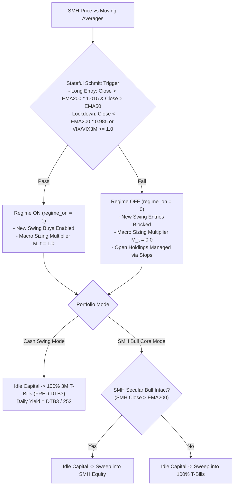

# SemiSwing Recommendation Metrics: Comprehensive Reference Guide

> [!IMPORTANT]
> This guide provides the complete mathematical definitions, operational thresholds, and economic interpretations for every metric, indicator, and machine learning attribution score displayed on **SemiSwing** daily trade tickets, email digests, and portfolio reports.

---

## 1. Master Recommendation Metrics Reference Table

The table below unifies all key metrics across the trade tickets, including **ML Score**, **Relative Strength (RS)**, execution bounds, and risk parameters.

| Metric | Ticket Label / Column | Formula & Code Location | Target Range / Gate | Economic Interpretation & Actionable Usage |
| :--- | :--- | :--- | :--- | :--- |
| **ML Score (Model Score)** | `ML Score` / `Model Score` | $\text{Baseline Score} \times S_{i,t}$<br>[`signal_models.py`](file:///Users/eric/Dropbox/ai/stock/src/semiswing/models/signal_models.py#L325) | $\ge 0.50$<br>(High: $\ge 1.50$) | Composite execution conviction combining trend quality with LightGBM continuous sizing scalar $S_{i,t} \in [0.50, 1.50]$. Determines ticket ranking in multi-signal queues. |
| **ML Win Probability** | `ML Win Prob` / `ml_prob` | $\hat{p}_{i,t} = \text{Platt}(\text{GBM}(X_{i,t}))$<br>[`signal_models.py`](file:///Users/eric/Dropbox/ai/stock/src/semiswing/models/signal_models.py#L209) | $p \ge 0.50$<br>(High: $p \ge 0.60$) | Calibrated out-of-fold probability that the trade achieves its $+1.5R$ profit target before hitting its $-1.0R$ stop or 25-day time stop. |
| **Relative Strength (RS)** | `RS xxth pct` / `rs_rank` | $\text{Rank}_{\text{univ}}\!\left(\sum_{\tau=0}^{19} (R_{i,\tau} - \beta R_{\text{SMH},\tau})\right)$<br>[`features/build.py`](file:///Users/eric/Dropbox/ai/stock/src/semiswing/features/build.py#L515) | $\ge 0.70$<br>($70\text{th}$ percentile) | Decoupled idiosyncratic momentum vs. `SMH`. At `96th pct`, the stock outperforms 96% of peer semiconductor/AI equities on a beta-neutral basis. |
| **Normalized Slope ($t$-stat)** | `slope_t_norm` | $t = \frac{\hat{\beta}_{L_t}}{\text{SE}(\hat{\beta}_{L_t})} \cdot \sqrt{\frac{20}{L_t}}$<br>[`features/build.py`](file:///Users/eric/Dropbox/ai/stock/src/semiswing/features/build.py#L289) | $\ge 1.50$<br>(Watch: $\ge 1.20$) | Statistical significance of upward price trajectory over adaptive volatility window $L_t$. Filters out choppy or drift-prone noise. |
| **Trend Linearity ($R^2$)** | `slope_r2` / `slope_r2_20d` | $R^2 = 1 - \frac{\text{SS}_{\text{res}}}{\text{SS}_{\text{tot}}}$<br>[`features/build.py`](file:///Users/eric/Dropbox/ai/stock/src/semiswing/features/build.py#L290) | $\ge 0.35$<br>($0.0 \to 1.0$) | Smoothness and consistency of the trend. High $R^2$ indicates steady institutional accumulation with shallow, orderly pullbacks. |
| **Trend Acceleration** | `slope_accel` | $\frac{\hat{\beta}_{10d} - \hat{\beta}_{40d}}{\sigma_{20d}}$<br>[`features/build.py`](file:///Users/eric/Dropbox/ai/stock/src/semiswing/features/build.py#L294) | $> 0.0$ | Second derivative of price momentum. Positive values confirm short-term trend speed is accelerating relative to medium-term baseline. |
| **Moving Average Extension** | `ext_atr` | $\frac{\text{Close} - \text{EMA}_{20}}{\text{ATR}_{14}}$<br>[`features/build.py`](file:///Users/eric/Dropbox/ai/stock/src/semiswing/features/build.py#L303) | $[-0.5, +2.5]$ | Normalized distance from 20-day exponential moving average. Prevents buying over-extended climaxes ($>2.5$) or broken trends ($<-0.5$). |
| **Initial Hard Stop** | `Hard Stop-Loss` | $\text{Close} - \min(2.0 \cdot \text{ATR}_{14}, 0.08 \cdot \text{Close})$<br>[`engine.py`](file:///Users/eric/Dropbox/ai/stock/src/semiswing/backtest/engine.py#L385) | $-4.0\%$ to $-8.0\%$ | Uncompromising downside risk threshold. Placed at market open upon trade fill; never widened or cancelled. |
| **Profit Target (TP1)** | `Profit Target (TP1)` | $\text{Close} + 3.0 \cdot \text{ATR}_{14}$<br>[`engine.py`](file:///Users/eric/Dropbox/ai/stock/src/semiswing/backtest/engine.py#L388) | $+6.0\%$ to $+15.0\%$ | Mathematical $+1.5R$ milestone. On touch, rules recommend taking profit on $25\%\text{--}50\%$ of shares and moving stop to breakeven. |
| **Chandelier Trailing Stop** | `Protect Stop` / `rec_stop` | $\max_{\tau \ge t_0}(\text{Close}_\tau) - 2.5 \cdot \text{ATR}_{14}$<br>[`engine.py`](file:///Users/eric/Dropbox/ai/stock/src/semiswing/backtest/engine.py#L425) | Ratchets upward only | Dynamic profit-preservation stop for open holdings. Locks in accrued gains during extended multi-week runners. |
| **R-Multiple** | `+x.xxR` | $\frac{\text{Close}_t - \text{Entry}}{1.0R}$ where $1.0R = \text{Entry} - \text{Stop}_0$<br>[`recommend/engine.py`](file:///Users/eric/Dropbox/ai/stock/src/semiswing/recommend/engine.py#L386) | Goal: $\ge +2.0R$ | Profit expressed in units of initial risk. Maintains positive portfolio expectancy even if overall win rate is modest. |
| **Position Sizing (Cash Only)** | `Order (Cash Only Pool)` | $\min\!\left(\frac{\text{Equity} \cdot 1\% \cdot M_t \cdot S_{i,t}}{\text{Risk/sh}}, \frac{\text{Cash}}{2}\right)$<br>[`recommend/engine.py`](file:///Users/eric/Dropbox/ai/stock/src/semiswing/recommend/engine.py#L123) | $\le 33\%$ Equity | Exact dollar and share allocation sized strictly using currently available settled idle cash. |
| **Position Sizing (With Rotation)** | `Order (With Rotate Pool)` | Allocation including rotation proceeds<br>[`recommend/engine.py`](file:///Users/eric/Dropbox/ai/stock/src/semiswing/recommend/engine.py#L123) | $\le 33\%$ Equity | Dollar and share allocation assuming scheduled liquidation of non-core or leveraged ETFs (`SOXL`, `TQQQ`) is executed. |
| **Days to Earnings** | `Earnings` / `dte` | Trading days until next confirmed report<br>[`features/build.py`](file:///Users/eric/Dropbox/ai/stock/src/semiswing/features/build.py#L325) | $> 5$ days | Blocks new entries within 5 days of earnings and triggers profit-trim alerts on existing holdings to avoid overnight gap risk. |

---

## 2. Machine Learning Attribution Drivers (SHAP Values)

In every candidate trade ticket, the engine reports the top 5 single-feature marginal attributions decomposing the LightGBM probability prediction:
```text
Drivers: vix_ts=0.89 (+0.051) | skew_idx=2.49 (+0.047) | resid_mom_60=0.49 (+0.033) | rs_rank=0.96 (+0.011) | vxn_squeeze_vel=0.34 (+0.011)
```

| Attribution Feature | Formula / Calculation | Institutional Threshold | Directional Impact & Economic Rationale |
| :--- | :--- | :--- | :--- |
| **`vix_ts`** | $\frac{\text{VIX}}{\text{VIX3M}}$ (CBOE Volatility Term Structure) | $< 0.95$ (Contango)<br>$\ge 1.00$ (Backwardation) | **$+$ when $< 1.0$ (Calm):** Front-month volatility trades at a discount to 3-month volatility, reflecting low immediate panic and positive risk appetite. |
| **`skew_idx`** | $\frac{\text{SKEW} - \mu_{60}(\text{SKEW})}{\sigma_{60}(\text{SKEW})}$ (20d $z$-score) | $> +1.50$ (Heavy Put Skew)<br>$< -1.00$ (Unhedged Complacency) | **$+$ when elevated:** Reflects institutional demand for out-of-the-money put protection. Heavily hedged markets lack panic sellers and fuel upside squeeze rallies. |
| **`resid_mom_60`** | $\sum_{\tau=0}^{59} (R_{i,\tau} - \beta_{120d} R_{\text{SMH},\tau})$ | $> 0.0$ (Positive Idiosyncratic Alpha) | **$+$ when high:** Measures 3-month stock outperformance independent of broader chip sector beta. Identifies fundamental accumulation leaders. |
| **`rs_rank`** | Cross-sectional percentile rank of `resid_mom_20` | $\ge 0.80$ ($80\text{th}$ percentile) | **$+$ when $> 0.80$:** Identifies short-term sector market leaders that attract liquidity during momentum breakouts. |
| **`vxn_squeeze_vel`** | $\frac{\Delta_5 \text{VXN} - \mu_{252}(\Delta_5)}{\sigma_{252}(\Delta_5)}$ | $< -0.50$ (Implied Vol Crushing) | **$+$ when negative/crushing:** Rapid drops in Nasdaq volatility signal short covering and aggressive equity inflows. |
| **`vol_compress`** | $\frac{\text{Realized Vol}_{10d}}{\text{Realized Vol}_{60d}}$ | $< 0.80$ (Volatility Contraction) | **$+$ when $< 1.0$:** A sharp contraction in short-term realized volatility signals coil consolidation prior to explosive directional breakout. |
| **`slope_t_norm`** | Adaptive OLS regression $t$-statistic on log close | $\ge 2.0$ (Strong Trend) | **$+$ when $> 1.5$:** Confirms persistent, low-variance upward drift over the volatility-calibrated lookback window $L_t$. |
| **`slope_r2_20d`** | Linear coefficient of determination over 20 bars | $\ge 0.50$ (Linear Channel) | **$+$ when $> 0.35$:** Penalizes high-volatility erratic spikes and rewards orderly channel trends. |

---

## 3. Macro Regime & Capital Allocation Filters

These indicators determine whether the strategy is deployed or sidelined in cash/T-bills:



### Macro Indicator Specifications
1. **Stateful Schmitt Trigger (`regime_on`):**
   - **Unlock Threshold:** $\text{Close}_{\text{SMH}} > \text{EMA}_{200} \times 1.015$ **AND** $\text{Close}_{\text{SMH}} > \text{EMA}_{50}$.
   - **Lockdown Threshold:** $\text{Close}_{\text{SMH}} < \text{EMA}_{200} \times 0.985$ **OR** $\frac{\text{VIX}}{\text{VIX3M}} \ge 1.00$ (volatility inversion).
   - **Hysteresis Band:** The $\pm 1.5\%$ band around the 200-day EMA eliminates whipsaw costs when the market oscillates near key moving averages.
2. **SMH Secular Bull Core (`smh_secular_bull`):**
   - Evaluates whether broad semiconductor structural compounding is active ($\text{Close}_{\text{SMH}} > \text{EMA}_{200}$).
   - In **SMH Bull Core Mode**, unallocated cash captures long-term sector upside during bull regimes and reverts to risk-free T-bills during cyclical bears (such as 2022).
3. **Premarket Circuit Breaker (`Premarket Gap-Down Guard`):**
   - If overnight semiconductor index futures or premarket prices drop $> -1.5\%$, all buy orders scheduled for market open are automatically cancelled.

---

## 4. Holdings Lifecycle & Action Tags (Step 1)

Holdings are evaluated daily and assigned an unambiguous action tag:

| Lifecycle Tag | Trigger Condition | Execution Rule |
| :--- | :--- | :--- |
| `[HOLD CORE]` | Ticker is designated core asset (`SMH`, `VOO`, `VGT`). | Permanent compounding allocation; never sold unless secular bull trigger breaks. |
| `[HOLD (PROTECT PROFIT)]` | Unrealized gain $> 0$, trailing stop ratcheting upward. | Maintain active position; adjust trailing stop order in broker to `Protect Stop`. |
| `[HOLD (EARNINGS WATCH)]` | Scheduled corporate earnings announcement within $\le 5$ trading days. | Consider trimming $25\%\text{--}50\%$ of shares into pre-earnings strength to eliminate binary gap risk. |
| `[SELL (STOP HIT)]` | Daily close breaches `Hard Stop` or `Chandelier Stop`. | **Execute immediate market open sale.** Capital protection is non-negotiable. |
| `[SELL / ROTATE]` | Position is in non-mandate or leveraged ETF (`SOXL`, `TQQQ`). | Liquidate at open and rotate capital into high-conviction single-stock consensus tickets. |

---

## 5. Daily Execution SOP for Traders

1. **Step 1 — Verify Sector Regime:** Check top banner for `regime_on`. If `DEFENSIVE / LOCKDOWN`, no new buy orders are authorized.
2. **Step 2 — Process Step 1 Holdings:**
   - Immediately execute any `[SELL (STOP HIT)]` orders at market open.
   - Update trailing stop levels in your brokerage account to match `Protect Stop`.
   - Trim any positions tagged `[HOLD (EARNINGS WATCH)]`.
3. **Step 3 — Place Step 2 Buy Orders:**
   - Select the Top 1 or 2 candidates from `CONSENSUS (ML + Baseline)` tickets.
   - Enter a market-on-open (or limit near close) order using the pre-calculated share count.
   - Immediately enter the **Hard Stop-Loss** order and **Profit Target (TP1)** order as a bracket / One-Cancels-Other (OCO) order in your brokerage.
