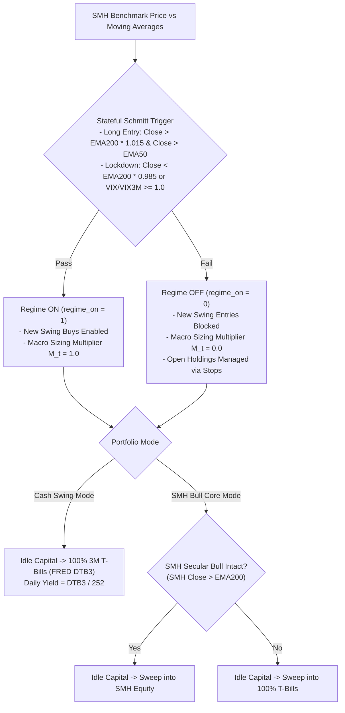

# SemiSwing Recommendation Metrics: Comprehensive Reference Guide

> [!IMPORTANT]
> This guide provides the complete mathematical definitions, operational thresholds, and economic interpretations for every metric, indicator, and machine learning attribution score displayed on **SemiSwing** daily trade tickets, email digests, and portfolio reports.

---

## 1. Quick Reference: Recommendation Metrics Table

| Metric | Ticket Label | Primary Mathematical Formulation | Target Threshold | Actionable Usage |
| :--- | :--- | :--- | :--- | :--- |
| **ML Score** | `ML Score` | $\text{Score}_{\text{ML}} = \text{Score}_{\text{Baseline}} \times S_{i,t}$ | $\ge 0.50$ (High: $\ge 1.50$) | Overall execution priority combining trend quality and ML confidence scalar $S_{i,t} \in [0.50, 1.50]$. |
| **ML Win Probability** | `ML Win Prob` / `ml_prob` | $\hat{p}_{i,t} = \sigma(A \cdot \ell_{i,t} + B)$ | $p \ge 0.50$ (High: $p \ge 0.60$) | Platt-calibrated out-of-fold probability that setup hits $+1.5R$ before $-1.0R$ stop or 25d time stop. |
| **Relative Strength (RS)** | `RS xxth pct` / `rs_rank` | $\text{RS}_{i,t} = \text{PercentileRank}_{j \in \mathcal{U}_t}(\text{ResMom}_{20}(j, t))$ | $\ge 0.70$ ($70\text{th}$ pct) | Idiosyncratic momentum vs. `SMH` benchmark. $96\text{th}$ pct means stock beats 96% of peers beta-neutrally. |
| **Normalized Slope ($t$-stat)** | `slope_t_norm` | $\tilde{t}_{L_t} = (\hat{\beta}_{L_t} / \text{SE}(\hat{\beta}_{L_t})) \times \sqrt{20 / L_t}$ | $\ge 1.50$ (Watch: $\ge 1.20$) | Statistical significance of upward price drift over volatility-adaptive window $L_t$. Filters noise. |
| **Trend Linearity ($R^2$)** | `slope_r2` / `slope_r2_20d` | $R^2 = 1 - (\text{SS}_{\text{res}} / \text{SS}_{\text{tot}})$ | $\ge 0.35$ ($0.0 \to 1.0$) | Smoothness and consistency of the trend channel. Penalizes erratic spikes and gaps. |
| **Trend Acceleration** | `slope_accel` | $\text{Acc}_t = (\hat{\beta}_{10d} - \hat{\beta}_{40d}) / \sigma_{20d}$ | $> 0.0$ | Second derivative of price momentum. Confirms short-term drift is accelerating vs. medium-term. |
| **Moving Average Extension** | `ext_atr` | $\text{Ext}_{\text{ATR}} = (P_t - \text{EMA}_{20}(t)) / \text{ATR}_{14}(t)$ | $[-0.5, +2.5]$ | Distance from 20d EMA in ATR units. Prevents buying over-extended climaxes ($>2.5$) or breakdowns ($<-0.5$). |
| **Initial Hard Stop** | `Hard Stop-Loss` | $P_{\text{stop}} = P_{\text{entry}} - \min(2.0 \cdot \text{ATR}_{14}, 0.08 \cdot P_{\text{entry}})$ | $-4.0\%$ to $-8.0\%$ | Non-negotiable downside exit placed at fill. Defines initial unit dollar risk ($1.0R$). |
| **Profit Target (TP1)** | `Profit Target (TP1)` | $P_{\text{TP1}} = P_{\text{entry}} + 3.0 \cdot \text{ATR}_{14} = P_{\text{entry}} + 1.5R$ | $+6.0\%$ to $+15.0\%$ | Mathematical $+1.5R$ milestone. Rules recommend taking 25%–50% profits and moving stop to breakeven. |
| **Chandelier Trailing Stop** | `Protect Stop` / `rec_stop` | $P_{\text{trail}}(t) = \max_{\tau \le t}(P_\tau) - 2.5 \cdot \text{ATR}_{14}(t)$ | Ratchets upward only | Dynamic profit-preservation stop for open holdings. Locks in accrued gains during runners. |
| **R-Multiple** | `+x.xxR` | $R_t = (P_t - P_{\text{entry}}) / (P_{\text{entry}} - P_{\text{stop}})$ | Goal: $\ge +2.0R$ | Profit in units of initial risk ($1.0R$). Maintains positive expectancy even with moderate win rate. |
| **Position Sizing (Cash Only)** | `Order (Cash Only Pool)` | Sized to $1\% \cdot E_t \cdot M_t \cdot S_{i,t}$, capped at $\text{Cash} / 2$ | $\le 33\%$ Equity | Dollar and share allocation funded strictly from currently settled idle cash. |
| **Position Sizing (With Rotate)** | `Order (With Rotate Pool)` | Sized with rotated proceeds added, capped at $C_{\text{rot}} / 2$ | $\le 33\%$ Equity | Dollar and share allocation assuming scheduled liquidation of non-core ETFs (`SOXL`, `TQQQ`). |
| **Days to Earnings** | `Earnings` / `dte` | Trading days until next scheduled quarterly report | $> 5$ days | Blocks new entries $\le 5$ days before earnings; prompts partial profit taking on existing holdings. |

---

## 2. Rigorous Mathematical Formulations & Derivations

### 2.1 Machine Learning Score & Continuous Meta-Labeling Sizing

The composite execution conviction $\text{Score}_{\text{ML}}(i, t)$ ranks qualifying trade candidates:

$$\text{Score}_{\text{ML}}(i, t) = \text{Score}_{\text{Baseline}}(i, t) \times S_{i,t}$$

where:

$$\text{Score}_{\text{Baseline}}(i, t) = \tilde{t}_{L_t}(i, t) \times \text{RS}_{i,t}$$

The continuous sizing scalar $S_{i,t} \in [0.50, 1.50]$ replaces discrete vetoes with an empirical percentile transformation of out-of-fold (OOF) model confidence:

$$S_{i,t} = 0.50 + F_{\text{OOF}}(\hat{p}_{i,t}) = 0.50 + \frac{1}{N_{\text{OOF}}} \sum_{k=1}^{N_{\text{OOF}}} \mathbf{1}_{\{\hat{p}_k \le \hat{p}_{i,t}\}}$$

- **Bottom Quintile ($S_{i,t} \in [0.50, 0.70]$):** Low-confidence setup; position size scaled down to $50\%\text{--}70\%$ of base risk.
- **Median Conviction ($S_{i,t} \approx 1.00$):** Standard baseline sizing ($1.0\%$ portfolio risk).
- **Top Decile ($S_{i,t} \in [1.30, 1.50]$):** High-conviction setup; position size scaled up to $130\%\text{--}150\%$ of base risk.

---

### 2.2 Platt-Calibrated Win Probability

For feature vector $\mathbf{x}_{i,t} \in \mathbb{R}^d$, the ensemble of LightGBM shallow gradient-boosted trees (`max_depth = 2`, `num_leaves = 4`) outputs raw ensemble probability $p_{\text{raw}}(\mathbf{x}_{i,t})$.

To prevent probability distortion and small-sample overfitting, 2-parameter Platt scaling is fitted on purged out-of-fold log-odds $\ell_{i,t}$:

$$\ell_{i,t} = \ln\left( \frac{p_{\text{raw}}(\mathbf{x}_{i,t})}{1 - p_{\text{raw}}(\mathbf{x}_{i,t})} \right)$$

$$\hat{p}_{i,t} = 0.70 \cdot \sigma\left( A \cdot \ell_{i,t} + B \right) + 0.30 \cdot p_{\text{raw}}(\mathbf{x}_{i,t})$$

where $\sigma(z) = \frac{1}{1 + e^{-z}}$, and $(A, B)$ are fitted via logistic maximum likelihood on purged validation folds to minimize Brier score loss:

$$\text{Brier} = \frac{1}{N} \sum_{j=1}^N (\hat{p}_j - y_j)^2, \quad y_j \in \{0, 1\}$$

Model skill over uninformative chance is verified by the **Brier Skill Score (BSS)**:

$$\text{BSS} = 1 - \frac{\text{Brier}_{\text{calibrated}}}{\text{Brier}_{\text{ref}}} = 1 - \frac{0.2404}{0.2500} = +0.0384 > 0.0200$$

---

### 2.3 Decoupled Relative Strength ($\text{RS}_{i,t}$)

To eliminate broad market beta distortion, single-stock log returns $r_{i,t} = \ln(P_{i,t} / P_{i,t-1})$ are regressed against benchmark returns $r_{\text{SMH},t}$ over a rolling 120-day window:

$$\beta_{i,t} = \min\left(3.0, \, \max\left(0.2, \, \frac{\text{Cov}_{120}(r_i, \, r_{\text{SMH}})}{\text{Var}_{120}(r_{\text{SMH}})}\right)\right)$$

The 20-day beta-decoupled idiosyncratic residual return is:

$$\text{ResMom}_{20}(i, t) = \sum_{k=0}^{19} \left( r_{i, t-k} - \beta_{i,t} \cdot r_{\text{SMH}, t-k} \right)$$

Cross-sectional ranking across all $N_t$ single equities in the active tradeable universe $\mathcal{U}_t$ yields:

$$\text{RS}_{i,t} = \frac{\text{Rank}_{j \in \mathcal{U}_t}\left(\text{ResMom}_{20}(j, t)\right)}{N_t} \in [0.0, 1.0]$$

For benchmark ETFs (`SMH`, `SOXX`), $\text{RS}$ is assigned $0.70$ if 20-day momentum exceeds `SPY`, else $0.30$.

---

### 2.4 Normalized Trend Slope ($\tilde{t}_{L_t}$) & Dynamic Lookback Window ($L_t$)

The lookback window $L_t \in [15, 60]$ dynamically scales inversely with short-term volatility:

$$L_t = \min\left(60, \, \max\left(15, \, \text{round}\left(20 \times \frac{\sigma_{250d}}{\sigma_{20d}}\right)\right)\right)$$

where $\sigma_{kd} = \text{std}_k(r_i) \times \sqrt{252}$ is annualized realized volatility.

Over the window $\tau \in [t - L_t + 1, t]$, linear regression of log price on time $\tau$ is:

$$\ln P_{i,\tau} = \alpha + \beta_{L_t} \cdot \tau + \epsilon_\tau$$

The slope $t$-statistic is normalized to a standardized 20-day horizon:

$$\tilde{t}_{L_t} = \frac{\hat{\beta}_{L_t}}{\text{SE}(\hat{\beta}_{L_t})} \times \sqrt{\frac{20}{L_t}}$$

where $\text{SE}(\hat{\beta}_{L_t}) = \sqrt{ \frac{\sum \hat{\epsilon}_\tau^2}{(L_t - 2) \sum (\tau - \bar{\tau})^2} }$.

---

### 2.5 Execution Stops & Profit Barriers

For entry at price $P_{\text{entry}}$ with 14-day Average True Range $\text{ATR}_{14}$:

1. **Initial Hard Stop:**
   $$P_{\text{stop}} = P_{\text{entry}} - \min\left(2.0 \cdot \text{ATR}_{14}(t_0), \, 0.08 \cdot P_{\text{entry}}\right)$$
   $$\text{Unit Risk } (1.0R) = P_{\text{entry}} - P_{\text{stop}}$$

2. **First Take-Profit Target (TP1):**
   $$P_{\text{TP1}} = P_{\text{entry}} + 3.0 \cdot \text{ATR}_{14}(t_0) = P_{\text{entry}} + 1.5 \cdot (1.0R)$$

3. **Chandelier Trailing Stop ($t > t_0$):**
   $$P_{\text{trail}}(t) = \max\left( P_{\text{trail}}(t-1), \, \max_{\tau \in [t_0, t]} (P_{i,\tau}) - 2.5 \cdot \text{ATR}_{14}(t) \right)$$

4. **Trade R-Multiple:**
   $$R_t = \frac{P_{i,t} - P_{\text{entry}}}{1.0R}$$

---

### 2.6 Hierarchical Position Sizing Formula

Given portfolio equity $E_t$, base risk fraction $f_{\text{risk}} = 0.01$ (1%), macro Schmitt multiplier $M_t \in \{0.0, 1.0\}$, ML scalar $S_{i,t} \in [0.50, 1.50]$, single-position cap $w_{\max} = 0.33$, and pool cash $C_t$ divided across $K_{\text{slots}} = 2$ slots:

$$N_{\text{shares}} = \min\left( \frac{E_t \times f_{\text{risk}} \times M_t \times S_{i,t}}{P_{\text{entry}} - P_{\text{stop}}}, \, \frac{E_t \times w_{\max} \times M_t}{P_{\text{entry}}}, \, \frac{C_t / K_{\text{slots}}}{P_{\text{entry}}} \right)$$

$$\text{Dollar Allocation} = N_{\text{shares}} \times P_{\text{entry}}$$

$$\text{Actual Capital at Risk} = N_{\text{shares}} \times (P_{\text{entry}} - P_{\text{stop}})$$

---

## 3. Machine Learning Attribution Drivers (SHAP Values)

In daily trade tickets, the engine extracts the top single-feature marginal contributions:
```text
Drivers: vix_ts=0.89 (+0.051) | skew_idx=2.49 (+0.047) | resid_mom_60=0.49 (+0.033) | rs_rank=0.96 (+0.011) | vxn_squeeze_vel=0.34 (+0.011)
```

| Attribution Feature | Mathematical Formulation | Normal Regime | Stress Regime | Economic Rationale |
| :--- | :--- | :--- | :--- | :--- |
| **`vix_ts`** | $\text{VIX}_t / \text{VIX3M}_t$ | $< 0.95$ (Contango) | $\ge 1.00$ (Backwardation) | Contango indicates calm volatility expectations. Backwardation reflects immediate hedging panic. |
| **`skew_idx`** | $(\text{SKEW}_t - \mu_{60}) / \sigma_{60}$ | $[0.0, +1.0]$ | $> +1.50$ (Heavy Put Demand) | High skew indicates institutions are heavily hedged with OTM puts, creating fuel for upside short squeezes. |
| **`resid_mom_60`** | $\sum_{k=0}^{59} (r_{i,t-k} - \beta_{120d} r_{\text{SMH},t-k})$ | $> 0.0$ | $< -0.10$ | 3-month cumulative alpha independent of broader chip sector moves. Confirms fundamental leadership. |
| **`rs_rank`** | Cross-sectional rank of $\text{ResMom}_{20}$ | $\ge 0.80$ ($80\text{th}$ pct) | $< 0.50$ | Identifies high-velocity market leaders that institutional money rotates into during momentum breakouts. |
| **`vxn_squeeze_vel`** | $(\Delta_5 \text{VXN}_t - \mu_{252}) / \sigma_{252}$ | $< -0.50$ (Crushing) | $> +1.50$ (Spiking) | Rapid drops in Nasdaq-100 implied volatility confirm aggressive institutional risk-on liquidity flows. |
| **`vol_compress`** | $\sigma_{10d}(t) / \sigma_{60d}(t)$ | $< 0.80$ (Contraction) | $> 1.30$ (Expansion) | Contraction in short-term volatility relative to medium-term baseline signals coil consolidation before expansion. |
| **`slope_t_norm`** | $\hat{\beta}_{L_t} / \text{SE}(\hat{\beta}_{L_t}) \cdot \sqrt{20 / L_t}$ | $\ge 2.0$ (Strong Trend) | $< 0.0$ (Downtrend) | Persistence and low-variance consistency of the upward price trajectory over window $L_t$. |
| **`slope_r2_20d`** | $1 - (\text{SS}_{\text{res}} / \text{SS}_{\text{tot}})$ | $\ge 0.50$ (Linear Channel) | $< 0.20$ (Noisy / Choppy) | Measures channel linearity over 20 bars. Penalizes erratic whipsaws and rewards steady accumulation. |

---

## 4. Macro Regime & Capital Allocation Filters



### Macro Indicator Specifications
1. **Stateful Schmitt Trigger (`regime_on`):**
   - **Unlock Threshold:** $P_{\text{SMH}, t} > \text{EMA}_{200}(t) \times 1.015$ **AND** $P_{\text{SMH}, t} > \text{EMA}_{50}(t)$.
   - **Lockdown Threshold:** $P_{\text{SMH}, t} < \text{EMA}_{200}(t) \times 0.985$ **OR** $\frac{\text{VIX}_t}{\text{VIX3M}_t} \ge 1.00$.
   - **Hysteresis Band:** The $\pm 1.5\%$ band around the 200-day EMA eliminates whipsaw costs when the market oscillates near key moving averages.
2. **SMH Secular Bull Core (`smh_secular_bull`):**
   - Evaluates whether broad semiconductor structural compounding is active ($P_{\text{SMH}, t} > \text{EMA}_{200}(t)$).
   - In **SMH Bull Core Mode**, unallocated cash captures long-term sector upside during bull regimes and sweeps to risk-free 3-Month T-Bills (`FRED DTB3`) during cyclical bears (e.g. 2022).
3. **Premarket Circuit Breaker:**
   - If overnight semiconductor index futures or premarket prices drop $> -1.5\%$, all buy orders scheduled for market open are automatically cancelled.

---

## 5. Holdings Lifecycle & Action Tags

| Lifecycle Tag | Trigger Condition | Execution Rule |
| :--- | :--- | :--- |
| `[HOLD CORE]` | Ticker is designated core asset (`SMH`, `VOO`, `VGT`). | Permanent compounding allocation; never sold unless secular bull trigger breaks. |
| `[HOLD (PROTECT PROFIT)]` | Unrealized gain $> 0$, trailing stop ratcheting upward. | Maintain active position; adjust trailing stop order in broker to `Protect Stop`. |
| `[HOLD (EARNINGS WATCH)]` | Scheduled corporate earnings announcement within $\le 5$ trading days. | Consider trimming $25\%\text{--}50\%$ of shares into pre-earnings strength to eliminate binary gap risk. |
| `[SELL (STOP HIT)]` | Daily close breaches `Hard Stop` or `Chandelier Stop`. | **Execute immediate market open sale.** Capital protection is non-negotiable. |
| `[SELL / ROTATE]` | Position is in non-mandate or leveraged ETF (`SOXL`, `TQQQ`). | Liquidate at open and rotate capital into high-conviction single-stock consensus tickets. |
