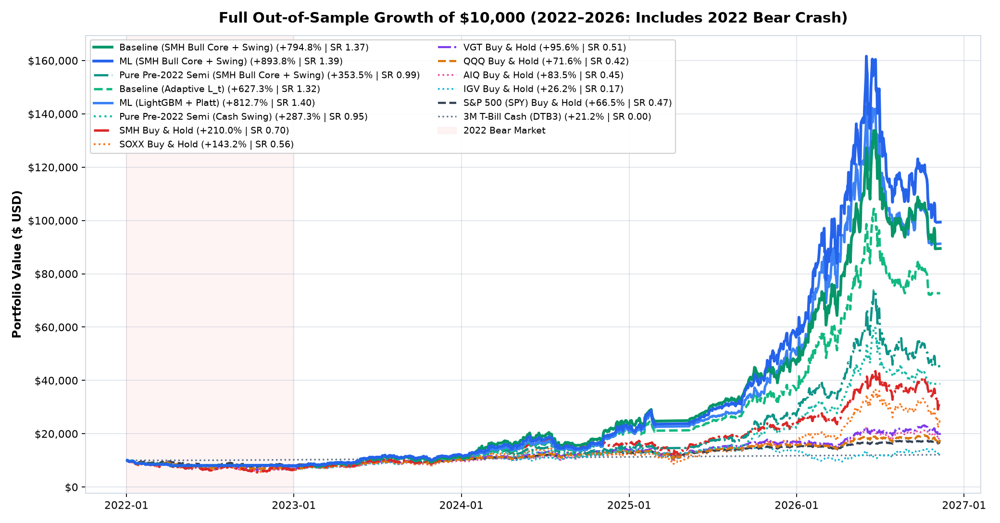
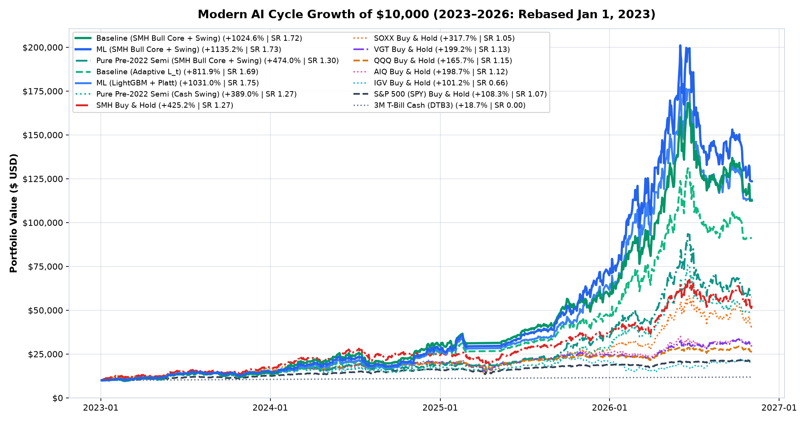
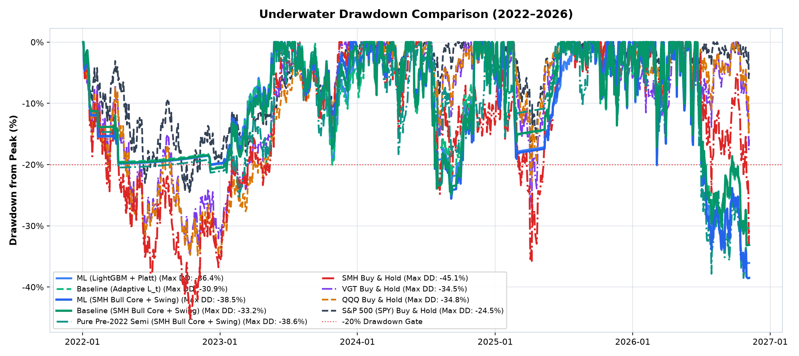
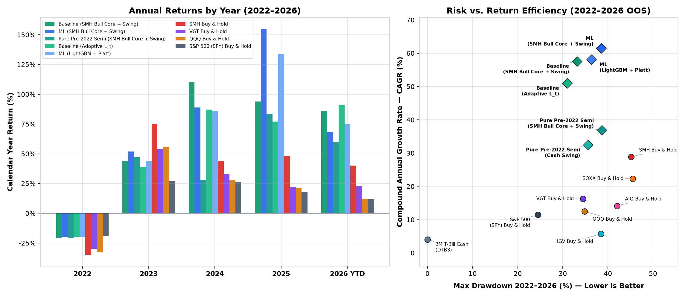

# SemiSwing Walk-Forward Backtest Report (2022–2026 Out-of-Sample)

- **Data Health Score:** `100.0/100`
- **Warmup Training Period:** `2018-01-01` to `2021-12-31`
- **Out-of-Sample Walk-Forward Period:** `2022-01-01` to Present
- **Platt Calibration OOF Brier Score:** Raw `0.2401` -> Calibrated `0.2401` (Brier Skill Score: `0.0395`)

## 1. Visual Benchmark Comparison Charts (`S&P 500`, `QQQ`, `VGT`, `SMH`, `SOXX`, `AIQ`, `IGV`, `T-Bills`)

### 1.1 Full Out-of-Sample Growth of `$10,000` (`2022–2026`, Includes 2022 Bear Market)

### 1.2 Modern AI Cycle Growth of `$10,000` (`2023–2026`, Rebased Jan 1, 2023)

### 1.3 Underwater Drawdown Comparison (`2022–2026`)

### 1.4 Calendar Year Returns & Risk-Return Efficiency (`2022–2026`)

## 2. Institutional Validation Gates (§9)

### 2.1 SMH Bull Core + Swing Mode (Active Secular Bull Core Sweep)

| Institutional Gate | Realized Metric | Gate Status |
| --- | --- | --- |
| `Gate 1: Modern AI Era Sharpe >= 1.60 (2023-2026)` | 1.67 | PASS |
| `Gate 2: Deflated Sharpe Probability >= 0.95 (K=14 trials)` | 0.946 | FAIL |
| `Gate 3: Profit Factor >= 2.00 (Gross Payoff Asymmetry)` | AI: 3.27 ; OOS: 3.09 | PASS |
| `Gate 4a: Modern AI Era Max DD <= 38.0% (vs SMH 35.7%)` | 39.14% | FAIL |
| `Gate 4b: Full OOS Max DD <= 40.0% (vs SMH 45.1%)` | 39.14% | PASS |
| `Gate 5: Full OOS Sharpe >= 1.20 (2022-2026 Full Cycle)` | 1.34 | PASS |
| `Gate 6: 2022 Bear Stress (Ret >= -40%, DD <= 40%, Cash >= 80%)` | Ret: -19.8% ; DD: 20.0% ; Cash: 89.6% | PASS |
| `Gate 7: ML Alpha Dominance & Calibration (BSS > 0.02 & SR Lift >= +0.05 or Sortino Lift >= +0.02 or CAGR Lift >= +3.0% or DD Red >= 1.5%)` | BSS: 0.0395 ; SR Lift: +0.00 ; Sortino Lift: +0.01 ; CAGR Lift: +6.8% ; DD Red: -6.2% | PASS |

### 2.2 Cash Swing Mode (100% Cash / T-Bill Secondary Default)

| Institutional Gate | Realized Metric | Gate Status |
| --- | --- | --- |
| `Gate 1: Modern AI Era Sharpe >= 1.50 (2023-2026)` | 1.64 | PASS |
| `Gate 2: Deflated Sharpe Probability >= 0.95 (K=14 trials)` | 0.941 | FAIL |
| `Gate 3: Profit Factor >= 1.50 (Gross Payoff Asymmetry)` | AI: 3.35 ; OOS: 3.13 | PASS |
| `Gate 4a: Modern AI Era Max DD <= 38.0% (vs SMH 35.7%)` | 37.58% | PASS |
| `Gate 4b: Full OOS Max DD <= 40.0% (vs SMH 45.1%)` | 37.58% | PASS |
| `Gate 5: Full OOS Sharpe >= 1.00 (2022-2026 Full Cycle)` | 1.31 | PASS |
| `Gate 6: 2022 Bear Stress (Ret >= -25%, DD <= 25%, Cash >= 80%)` | Ret: -19.9% ; DD: 20.1% ; Cash: 89.6% | PASS |
| `Gate 7: ML Alpha Dominance & Calibration (BSS > 0.02 & SR Lift >= +0.05 or Sortino Lift >= +0.02 or CAGR Lift >= +3.0% or DD Red >= 1.5%)` | BSS: 0.0395 ; SR Lift: +0.02 ; Sortino Lift: +0.02 ; CAGR Lift: +10.5% ; DD Red: -7.1% | PASS |

## 3. Full Out-of-Sample Walk-Forward (`2022–2026`)

| Strategy / Benchmark | Total Return (%) | CAGR (%) | Sharpe | Deflated SR Prob | Sortino | Max DD (%) | 100% Cash Days (%) | Trades | Win Rate (%) | Profit Factor | Avg R |
| --- | --- | --- | --- | --- | --- | --- | --- | --- | --- | --- | --- |
| Baseline (SMH Bull Core + Swing) | 712.87 | 54.05 | 1.33 | 0.894 | 1.37 | 32.95 | 26.8 | 98 | 50.0 | 3.16 | 1.44 |
| ML (SMH Bull Core + Swing) | 843.43 | 58.86 | 1.34 | 0.901 | 1.4 | 39.14 | 26.4 | 98 | 43.9 | 3.09 | 1.5 |
| Pure Pre-2022 Semi (SMH Bull Core + Swing) | 353.7 | 36.6 | 0.98 | 0.69 | 0.98 | 38.63 | 28.4 | 89 | 52.8 | 2.75 | 1.16 |
| `Baseline (Adaptive `L_t`)` | 548.61 | 47.04 | 1.27 | 0.87 | 1.33 | 30.47 | 26.8 | 97 | 49.5 | 3.2 | 1.41 |
| ML (LightGBM + Platt) | 719.36 | 54.3 | 1.31 | 0.89 | 1.38 | 37.58 | 26.4 | 97 | 43.3 | 3.13 | 1.51 |
| Pure Pre-2022 Semi (Cash Swing) | 287.48 | 32.22 | 0.95 | 0.66 | 0.97 | 35.6 | 28.4 | 90 | 52.2 | 2.76 | 1.14 |
| Baseline (Fixed 20d) | 563.11 | 47.72 | 1.26 | 0.864 | 1.31 | 31.34 | 25.9 | 104 | 45.2 | 3.41 | 1.47 |
| SMH Buy & Hold | 212.45 | 26.48 | 0.71 | 0.456 | 0.69 | 45.14 | 0.0 | 0 | 0.0 | 0.0 | 0.0 |
| SOXX Buy & Hold | 148.71 | 20.67 | 0.57 | 0.341 | 0.56 | 45.52 | 0.0 | 0 | 0.0 | 0.0 | 0.0 |
| VGT Buy & Hold | 97.23 | 15.04 | 0.51 | 0.294 | 0.49 | 34.5 | 0.0 | 0 | 0.0 | 0.0 | 0.0 |
| QQQ Buy & Hold | 73.27 | 12.0 | 0.43 | 0.237 | 0.42 | 34.83 | 0.0 | 0 | 0.0 | 0.0 | 0.0 |
| AIQ Buy & Hold | 85.19 | 13.55 | 0.46 | 0.256 | 0.45 | 42.02 | 0.0 | 0 | 0.0 | 0.0 | 0.0 |
| IGV Buy & Hold | 28.27 | 5.27 | 0.18 | 0.104 | 0.18 | 38.49 | 0.0 | 0 | 0.0 | 0.0 | 0.0 |
| S&P 500 (SPY) Buy & Hold | 67.57 | 11.23 | 0.47 | 0.265 | 0.46 | 24.5 | 0.0 | 0 | 0.0 | 0.0 | 0.0 |
| 3M T-Bill Cash (DTB3) | 21.27 | 4.06 | 0.0 | 0.0 | 0.0 | 0.0 | 100.0 | 0 | 0.0 | 0.0 | 0.0 |

## 4. View A — 2022 Bear Market Stress Test (`2022`)

| Strategy / Benchmark | Total Return (%) | CAGR (%) | Sharpe | Deflated SR Prob | Sortino | Max DD (%) | 100% Cash Days (%) | Trades | Win Rate (%) | Profit Factor | Avg R |
| --- | --- | --- | --- | --- | --- | --- | --- | --- | --- | --- | --- |
| Baseline (SMH Bull Core + Swing) | -20.51 | -20.59 | -2.68 | 0.0 | -2.12 | 20.77 | 89.6 | 15 | 0.0 | 0.0 | -0.62 |
| ML (SMH Bull Core + Swing) | -19.81 | -19.88 | -2.54 | 0.0 | -2.03 | 20.02 | 89.6 | 17 | 0.0 | 0.0 | -0.6 |
| Pure Pre-2022 Semi (SMH Bull Core + Swing) | -21.07 | -21.14 | -2.63 | 0.0 | -2.07 | 21.33 | 89.6 | 14 | 0.0 | 0.0 | -0.68 |
| `Baseline (Adaptive `L_t`)` | -20.32 | -20.39 | -2.7 | 0.0 | -2.13 | 20.59 | 89.6 | 15 | 0.0 | 0.0 | -0.62 |
| ML (LightGBM + Platt) | -19.91 | -19.98 | -2.56 | 0.0 | -2.04 | 20.12 | 89.6 | 17 | 0.0 | 0.0 | -0.6 |
| Pure Pre-2022 Semi (Cash Swing) | -20.88 | -20.95 | -2.64 | 0.0 | -2.06 | 21.14 | 89.6 | 14 | 0.0 | 0.0 | -0.68 |
| Baseline (Fixed 20d) | -15.72 | -15.78 | -2.41 | 0.0 | -1.94 | 16.0 | 88.8 | 13 | 0.0 | 0.0 | -0.56 |
| SMH Buy & Hold | -34.97 | -35.08 | -0.85 | 0.0 | -0.87 | 45.14 | 0.0 | 0 | 0.0 | 0.0 | 0.0 |
| SOXX Buy & Hold | -36.35 | -36.47 | -0.88 | 0.0 | -0.89 | 45.52 | 0.0 | 0 | 0.0 | 0.0 | 0.0 |
| VGT Buy & Hold | -30.28 | -30.38 | -0.96 | 0.0 | -0.98 | 34.5 | 0.0 | 0 | 0.0 | 0.0 | 0.0 |
| QQQ Buy & Hold | -33.22 | -33.33 | -1.17 | 0.0 | -1.19 | 34.83 | 0.0 | 0 | 0.0 | 0.0 | 0.0 |
| AIQ Buy & Hold | -36.62 | -36.74 | -1.2 | 0.0 | -1.24 | 42.02 | 0.0 | 0 | 0.0 | 0.0 | 0.0 |
| IGV Buy & Hold | -34.91 | -35.02 | -1.0 | 0.0 | -1.02 | 38.49 | 0.0 | 0 | 0.0 | 0.0 | 0.0 |
| S&P 500 (SPY) Buy & Hold | -18.65 | -18.71 | -0.82 | 0.0 | -0.85 | 24.5 | 0.0 | 0 | 0.0 | 0.0 | 0.0 |
| 3M T-Bill Cash (DTB3) | 2.03 | 2.04 | 0.0 | 0.0 | 0.0 | 0.0 | 100.0 | 0 | 0.0 | 0.0 | 0.0 |

## 5. View B — Modern AI Cycle (`2023–2026`)

| Strategy / Benchmark | Total Return (%) | CAGR (%) | Sharpe | Deflated SR Prob | Sortino | Max DD (%) | 100% Cash Days (%) | Trades | Win Rate (%) | Profit Factor | Avg R |
| --- | --- | --- | --- | --- | --- | --- | --- | --- | --- | --- | --- |
| Baseline (SMH Bull Core + Swing) | 922.49 | 82.82 | 1.67 | 0.945 | 1.69 | 32.95 | 10.5 | 83 | 59.0 | 3.41 | 1.81 |
| ML (SMH Bull Core + Swing) | 1076.24 | 89.59 | 1.67 | 0.946 | 1.7 | 39.14 | 10.0 | 81 | 53.1 | 3.27 | 1.94 |
| Pure Pre-2022 Semi (SMH Bull Core + Swing) | 474.71 | 57.43 | 1.29 | 0.803 | 1.27 | 38.63 | 12.6 | 75 | 62.7 | 3.14 | 1.5 |
| `Baseline (Adaptive `L_t`)` | 713.9 | 72.31 | 1.62 | 0.934 | 1.67 | 30.47 | 10.5 | 82 | 58.5 | 3.52 | 1.78 |
| ML (LightGBM + Platt) | 922.83 | 82.84 | 1.64 | 0.941 | 1.69 | 37.58 | 10.0 | 80 | 52.5 | 3.35 | 1.96 |
| Pure Pre-2022 Semi (Cash Swing) | 389.65 | 51.02 | 1.27 | 0.79 | 1.29 | 35.6 | 12.6 | 76 | 61.8 | 3.21 | 1.47 |
| Baseline (Fixed 20d) | 686.64 | 70.8 | 1.56 | 0.916 | 1.6 | 31.34 | 9.6 | 91 | 51.6 | 3.69 | 1.76 |
| SMH Buy & Hold | 384.17 | 50.58 | 1.18 | 0.744 | 1.15 | 35.74 | 0.0 | 0 | 0.0 | 0.0 | 0.0 |
| SOXX Buy & Hold | 294.6 | 42.8 | 0.99 | 0.611 | 0.97 | 41.36 | 0.0 | 0 | 0.0 | 0.0 | 0.0 |
| VGT Buy & Hold | 185.62 | 31.31 | 1.06 | 0.663 | 1.0 | 27.23 | 0.0 | 0 | 0.0 | 0.0 | 0.0 |
| QQQ Buy & Hold | 161.23 | 28.3 | 1.1 | 0.69 | 1.07 | 22.77 | 0.0 | 0 | 0.0 | 0.0 | 0.0 |
| AIQ Buy & Hold | 192.06 | 32.07 | 1.07 | 0.67 | 1.03 | 26.35 | 0.0 | 0 | 0.0 | 0.0 | 0.0 |
| IGV Buy & Hold | 96.65 | 19.19 | 0.63 | 0.334 | 0.62 | 36.61 | 0.0 | 0 | 0.0 | 0.0 | 0.0 |
| S&P 500 (SPY) Buy & Hold | 106.84 | 20.76 | 1.03 | 0.642 | 1.02 | 18.76 | 0.0 | 0 | 0.0 | 0.0 | 0.0 |
| 3M T-Bill Cash (DTB3) | 18.83 | 4.58 | 0.0 | 0.0 | 0.0 | 0.0 | 100.0 | 0 | 0.0 | 0.0 | 0.0 |

## 6. Yearly Breakdown — Baseline (Adaptive `L_t`, Cash + T-Bill Interest)

| Year | Total Return (%) | CAGR (%) | Ann. Vol (%) | Sharpe | Sortino | Max Drawdown (%) | 100% Cash Days (%) | Trades | Win Rate (%) | Profit Factor | Avg R |
| --- | --- | --- | --- | --- | --- | --- | --- | --- | --- | --- | --- |
| 2022 | -20.32% | -20.39% | 9.1% | -2.70 | -2.13 | -20.59% | 89.6% | 15 | 0.0% | 0.00 | -0.62R |
| 2023 | +39.21% | +39.58% | 20.3% | 1.50 | 1.53 | -20.05% | 6.0% | 24 | 70.8% | 3.47 | +1.04R |
| 2024 | +74.08% | +74.08% | 31.4% | 1.77 | 2.00 | -27.21% | 8.3% | 24 | 58.3% | 3.87 | +1.03R |
| 2025 | +64.66% | +65.32% | 30.9% | 1.66 | 1.65 | -16.39% | 20.4% | 16 | 50.0% | 8.87 | +5.12R |
| 2026 | +95.71% | +116.55% | 51.0% | 1.71 | 1.71 | -30.47% | 6.8% | 18 | 50.0% | 1.56 | +0.81R |

## 7. Yearly Breakdown — ML (LightGBM + Platt, Cash + T-Bill Interest)

| Year | Total Return (%) | CAGR (%) | Ann. Vol (%) | Sharpe | Sortino | Max Drawdown (%) | 100% Cash Days (%) | Trades | Win Rate (%) | Profit Factor | Avg R |
| --- | --- | --- | --- | --- | --- | --- | --- | --- | --- | --- | --- |
| 2022 | -19.91% | -19.98% | 9.4% | -2.56 | -2.04 | -20.12% | 89.6% | 17 | 0.0% | 0.00 | -0.60R |
| 2023 | +43.95% | +44.37% | 20.5% | 1.66 | 1.72 | -19.32% | 6.0% | 25 | 68.0% | 4.10 | +0.89R |
| 2024 | +72.66% | +72.66% | 31.8% | 1.73 | 1.91 | -27.54% | 8.3% | 24 | 45.8% | 3.44 | +0.89R |
| 2025 | +126.53% | +128.02% | 36.1% | 2.36 | 2.56 | -19.17% | 20.4% | 12 | 58.3% | 32.52 | +8.39R |
| 2026 | +75.40% | +90.90% | 58.9% | 1.33 | 1.31 | -37.58% | 4.6% | 19 | 36.8% | 1.16 | +0.65R |
