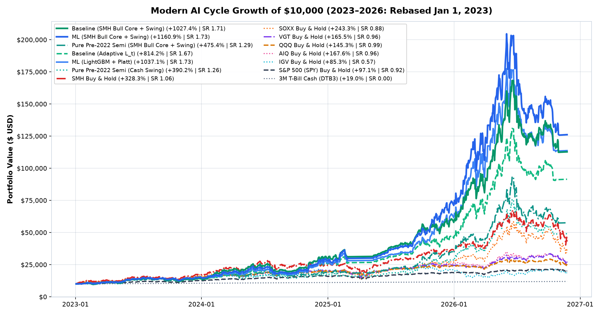

# SemiSwing Walk-Forward Backtest Report (2022–2026 Out-of-Sample)

- **Data Health Score:** `100.0/100`
- **Warmup Training Period:** `2018-01-01` to `2021-12-31`
- **Out-of-Sample Walk-Forward Period:** `2022-01-01` to Present
- **Platt Calibration OOF Brier Score:** Raw `0.2391` -> Calibrated `0.2391` (Brier Skill Score: `0.0435`)

## 1. Visual Benchmark Comparison Charts (`S&P 500`, `QQQ`, `VGT`, `SMH`, `SOXX`, `AIQ`, `IGV`, `T-Bills`)

### 1.1 Full Out-of-Sample Growth of `$10,000` (`2022–2026`, Includes 2022 Bear Market)

### 1.2 Modern AI Cycle Growth of `$10,000` (`2023–2026`, Rebased Jan 1, 2023)

### 1.3 Underwater Drawdown Comparison (`2022–2026`)

### 1.4 Calendar Year Returns & Risk-Return Efficiency (`2022–2026`)

## 2. Institutional Validation Gates (§9)

### 2.1 SMH Bull Core + Swing Mode (Active Secular Bull Core Sweep)

| Institutional Gate | Realized Metric | Gate Status |
| --- | --- | --- |
| `Gate 1: Modern AI Era Sharpe >= 1.60 (2023-2026)` | 1.69 | PASS |
| `Gate 2: Deflated Sharpe Probability >= 0.95 (K=14 trials)` | 0.951 | PASS |
| `Gate 3: Profit Factor >= 2.00 (Gross Payoff Asymmetry)` | AI: 3.57 ; OOS: 3.34 | PASS |
| `Gate 4a: Modern AI Era Max DD <= 38.0% (vs SMH 35.7%)` | 37.75% | PASS |
| `Gate 4b: Full OOS Max DD <= 40.0% (vs SMH 45.1%)` | 37.75% | PASS |
| `Gate 5: Full OOS Sharpe >= 1.20 (2022-2026 Full Cycle)` | 1.36 | PASS |
| `Gate 6: 2022 Bear Stress (Ret >= -40%, DD <= 40%, Cash >= 80%)` | Ret: -20.8% ; DD: 21.0% ; Cash: 89.6% | PASS |
| `Gate 7: ML Alpha Dominance & Calibration (BSS > 0.02 & SR Lift >= +0.05 or Sortino Lift >= +0.02 or CAGR Lift >= +3.0% or DD Red >= 1.5%)` | BSS: 0.0435 ; SR Lift: +0.03 ; Sortino Lift: +0.06 ; CAGR Lift: +6.9% ; DD Red: -1.9% | PASS |

### 2.2 Cash Swing Mode (100% Cash / T-Bill Secondary Default)

| Institutional Gate | Realized Metric | Gate Status |
| --- | --- | --- |
| `Gate 1: Modern AI Era Sharpe >= 1.50 (2023-2026)` | 1.69 | PASS |
| `Gate 2: Deflated Sharpe Probability >= 0.95 (K=14 trials)` | 0.953 | PASS |
| `Gate 3: Profit Factor >= 1.50 (Gross Payoff Asymmetry)` | AI: 3.66 ; OOS: 3.39 | PASS |
| `Gate 4a: Modern AI Era Max DD <= 38.0% (vs SMH 35.7%)` | 36.48% | PASS |
| `Gate 4b: Full OOS Max DD <= 40.0% (vs SMH 45.1%)` | 36.48% | PASS |
| `Gate 5: Full OOS Sharpe >= 1.00 (2022-2026 Full Cycle)` | 1.34 | PASS |
| `Gate 6: 2022 Bear Stress (Ret >= -25%, DD <= 25%, Cash >= 80%)` | Ret: -20.9% ; DD: 21.1% ; Cash: 89.6% | PASS |
| `Gate 7: ML Alpha Dominance & Calibration (BSS > 0.02 & SR Lift >= +0.05 or Sortino Lift >= +0.02 or CAGR Lift >= +3.0% or DD Red >= 1.5%)` | BSS: 0.0435 ; SR Lift: +0.10 ; Sortino Lift: +0.13 ; CAGR Lift: +12.5% ; DD Red: -0.4% | PASS |

## 3. Full Out-of-Sample Walk-Forward (`2022–2026`)

| Strategy / Benchmark | Total Return (%) | CAGR (%) | Sharpe | Deflated SR Prob | Sortino | Max DD (%) | 100% Cash Days (%) | Trades | Win Rate (%) | Profit Factor | Avg R |
| --- | --- | --- | --- | --- | --- | --- | --- | --- | --- | --- | --- |
| Baseline (SMH Bull Core + Swing) | 736.94 | 54.76 | 1.32 | 0.892 | 1.35 | 35.9 | 26.8 | 99 | 47.5 | 2.69 | 1.41 |
| ML (SMH Bull Core + Swing) | 863.09 | 59.29 | 1.36 | 0.907 | 1.41 | 37.75 | 26.8 | 98 | 42.9 | 3.34 | 1.48 |
| Pure Pre-2022 Semi (SMH Bull Core + Swing) | 286.64 | 32.04 | 0.89 | 0.618 | 0.89 | 39.24 | 28.9 | 95 | 54.7 | 2.25 | 1.0 |
| `Baseline (Adaptive `L_t`)` | 558.15 | 47.3 | 1.25 | 0.861 | 1.3 | 36.04 | 26.8 | 98 | 46.9 | 2.77 | 1.39 |
| ML (LightGBM + Platt) | 758.98 | 55.59 | 1.34 | 0.905 | 1.42 | 36.48 | 26.8 | 98 | 43.9 | 3.39 | 1.49 |
| Pure Pre-2022 Semi (Cash Swing) | 195.69 | 24.96 | 0.77 | 0.512 | 0.79 | 36.28 | 28.9 | 98 | 53.1 | 2.21 | 0.95 |
| Baseline (Fixed 20d) | 559.96 | 47.38 | 1.22 | 0.846 | 1.28 | 35.59 | 26.8 | 104 | 47.1 | 3.08 | 1.2 |
| SMH Buy & Hold | 193.38 | 24.76 | 0.67 | 0.425 | 0.66 | 45.14 | 0.0 | 0 | 0.0 | 0.0 | 0.0 |
| SOXX Buy & Hold | 134.79 | 19.18 | 0.54 | 0.317 | 0.53 | 45.52 | 0.0 | 0 | 0.0 | 0.0 | 0.0 |
| VGT Buy & Hold | 88.45 | 13.91 | 0.47 | 0.267 | 0.45 | 34.5 | 0.0 | 0 | 0.0 | 0.0 | 0.0 |
| QQQ Buy & Hold | 66.1 | 10.99 | 0.39 | 0.212 | 0.38 | 34.83 | 0.0 | 0 | 0.0 | 0.0 | 0.0 |
| AIQ Buy & Hold | 73.46 | 11.99 | 0.41 | 0.221 | 0.4 | 42.02 | 0.0 | 0 | 0.0 | 0.0 | 0.0 |
| IGV Buy & Hold | 22.81 | 4.31 | 0.15 | 0.092 | 0.15 | 38.49 | 0.0 | 0 | 0.0 | 0.0 | 0.0 |
| S&P 500 (SPY) Buy & Hold | 60.32 | 10.19 | 0.42 | 0.227 | 0.41 | 24.5 | 0.0 | 0 | 0.0 | 0.0 | 0.0 |
| 3M T-Bill Cash (DTB3) | 21.35 | 4.06 | 0.0 | 0.0 | 0.0 | 0.0 | 100.0 | 0 | 0.0 | 0.0 | 0.0 |

## 4. View A — 2022 Bear Market Stress Test (`2022`)

| Strategy / Benchmark | Total Return (%) | CAGR (%) | Sharpe | Deflated SR Prob | Sortino | Max DD (%) | 100% Cash Days (%) | Trades | Win Rate (%) | Profit Factor | Avg R |
| --- | --- | --- | --- | --- | --- | --- | --- | --- | --- | --- | --- |
| Baseline (SMH Bull Core + Swing) | -20.69 | -20.76 | -2.7 | 0.0 | -2.13 | 20.95 | 89.6 | 15 | 0.0 | 0.0 | -0.62 |
| ML (SMH Bull Core + Swing) | -20.82 | -20.89 | -2.49 | 0.0 | -1.96 | 21.03 | 89.6 | 17 | 0.0 | 0.0 | -0.62 |
| Pure Pre-2022 Semi (SMH Bull Core + Swing) | -20.34 | -20.42 | -2.57 | 0.0 | -2.02 | 20.6 | 89.6 | 13 | 0.0 | 0.0 | -0.68 |
| `Baseline (Adaptive `L_t`)` | -20.5 | -20.57 | -2.72 | 0.0 | -2.14 | 20.76 | 89.6 | 15 | 0.0 | 0.0 | -0.62 |
| ML (LightGBM + Platt) | -20.92 | -20.99 | -2.51 | 0.0 | -1.97 | 21.13 | 89.6 | 17 | 0.0 | 0.0 | -0.62 |
| Pure Pre-2022 Semi (Cash Swing) | -20.18 | -20.26 | -2.58 | 0.0 | -2.03 | 20.45 | 89.6 | 13 | 0.0 | 0.0 | -0.68 |
| Baseline (Fixed 20d) | -15.72 | -15.78 | -2.41 | 0.0 | -1.94 | 16.0 | 88.8 | 13 | 0.0 | 0.0 | -0.56 |
| SMH Buy & Hold | -34.97 | -35.08 | -0.85 | 0.0 | -0.87 | 45.14 | 0.0 | 0 | 0.0 | 0.0 | 0.0 |
| SOXX Buy & Hold | -36.35 | -36.47 | -0.88 | 0.0 | -0.89 | 45.52 | 0.0 | 0 | 0.0 | 0.0 | 0.0 |
| VGT Buy & Hold | -30.28 | -30.38 | -0.96 | 0.0 | -0.98 | 34.5 | 0.0 | 0 | 0.0 | 0.0 | 0.0 |
| QQQ Buy & Hold | -33.22 | -33.33 | -1.17 | 0.0 | -1.19 | 34.83 | 0.0 | 0 | 0.0 | 0.0 | 0.0 |
| AIQ Buy & Hold | -36.62 | -36.74 | -1.2 | 0.0 | -1.24 | 42.02 | 0.0 | 0 | 0.0 | 0.0 | 0.0 |
| IGV Buy & Hold | -34.91 | -35.02 | -1.0 | 0.0 | -1.02 | 38.49 | 0.0 | 0 | 0.0 | 0.0 | 0.0 |
| S&P 500 (SPY) Buy & Hold | -18.65 | -18.71 | -0.82 | 0.0 | -0.85 | 24.5 | 0.0 | 0 | 0.0 | 0.0 | 0.0 |
| 3M T-Bill Cash (DTB3) | 2.03 | 2.04 | 0.0 | 0.0 | 0.0 | 0.0 | 100.0 | 0 | 0.0 | 0.0 | 0.0 |

## 5. View B — Modern AI Cycle (`2023–2026`)

| Strategy / Benchmark | Total Return (%) | CAGR (%) | Sharpe | Deflated SR Prob | Sortino | Max DD (%) | 100% Cash Days (%) | Trades | Win Rate (%) | Profit Factor | Avg R |
| --- | --- | --- | --- | --- | --- | --- | --- | --- | --- | --- | --- |
| Baseline (SMH Bull Core + Swing) | 955.09 | 83.86 | 1.66 | 0.943 | 1.66 | 35.9 | 10.7 | 84 | 56.0 | 2.85 | 1.78 |
| ML (SMH Bull Core + Swing) | 1116.07 | 90.73 | 1.69 | 0.951 | 1.72 | 37.75 | 10.7 | 81 | 51.9 | 3.57 | 1.92 |
| Pure Pre-2022 Semi (SMH Bull Core + Swing) | 385.3 | 50.42 | 1.18 | 0.743 | 1.16 | 39.24 | 13.2 | 82 | 63.4 | 2.54 | 1.27 |
| `Baseline (Adaptive `L_t`)` | 727.7 | 72.68 | 1.59 | 0.928 | 1.62 | 36.04 | 10.7 | 83 | 55.4 | 2.98 | 1.75 |
| ML (LightGBM + Platt) | 986.0 | 85.23 | 1.69 | 0.953 | 1.75 | 36.48 | 10.7 | 81 | 53.1 | 3.66 | 1.93 |
| Pure Pre-2022 Semi (Cash Swing) | 270.4 | 40.27 | 1.06 | 0.664 | 1.08 | 36.28 | 13.2 | 85 | 61.2 | 2.58 | 1.2 |
| Baseline (Fixed 20d) | 682.91 | 70.21 | 1.51 | 0.902 | 1.55 | 35.59 | 10.9 | 91 | 53.8 | 3.3 | 1.45 |
| SMH Buy & Hold | 354.62 | 47.9 | 1.13 | 0.713 | 1.11 | 35.74 | 0.0 | 0 | 0.0 | 0.0 | 0.0 |
| SOXX Buy & Hold | 272.51 | 40.48 | 0.95 | 0.581 | 0.92 | 41.36 | 0.0 | 0 | 0.0 | 0.0 | 0.0 |
| VGT Buy & Hold | 172.91 | 29.63 | 1.01 | 0.625 | 0.95 | 27.23 | 0.0 | 0 | 0.0 | 0.0 | 0.0 |
| QQQ Buy & Hold | 150.42 | 26.78 | 1.04 | 0.649 | 1.01 | 22.77 | 0.0 | 0 | 0.0 | 0.0 | 0.0 |
| AIQ Buy & Hold | 173.57 | 29.71 | 1.0 | 0.617 | 0.96 | 26.35 | 0.0 | 0 | 0.0 | 0.0 | 0.0 |
| IGV Buy & Hold | 88.29 | 17.77 | 0.58 | 0.303 | 0.57 | 36.61 | 0.0 | 0 | 0.0 | 0.0 | 0.0 |
| S&P 500 (SPY) Buy & Hold | 97.9 | 19.29 | 0.95 | 0.58 | 0.93 | 18.76 | 0.0 | 0 | 0.0 | 0.0 | 0.0 |
| 3M T-Bill Cash (DTB3) | 18.91 | 4.58 | 0.0 | 0.0 | 0.0 | 0.0 | 100.0 | 0 | 0.0 | 0.0 | 0.0 |

## 6. Yearly Breakdown — Baseline (Adaptive `L_t`, Cash + T-Bill Interest)

| Year | Total Return (%) | CAGR (%) | Ann. Vol (%) | Sharpe | Sortino | Max Drawdown (%) | 100% Cash Days (%) | Trades | Win Rate (%) | Profit Factor | Avg R |
| --- | --- | --- | --- | --- | --- | --- | --- | --- | --- | --- | --- |
| 2022 | -20.50% | -20.57% | 9.1% | -2.72 | -2.14 | -20.76% | 89.6% | 15 | 0.0% | 0.00 | -0.62R |
| 2023 | +39.21% | +39.58% | 20.3% | 1.50 | 1.53 | -20.05% | 6.0% | 24 | 70.8% | 3.47 | +1.04R |
| 2024 | +86.93% | +86.93% | 32.4% | 1.95 | 2.15 | -21.93% | 7.5% | 22 | 63.6% | 5.06 | +1.25R |
| 2025 | +77.51% | +78.33% | 32.2% | 1.84 | 1.86 | -16.08% | 20.4% | 16 | 50.0% | 9.89 | +5.33R |
| 2026 | +73.19% | +86.01% | 52.1% | 1.39 | 1.37 | -36.04% | 8.5% | 21 | 33.3% | 1.01 | +0.36R |

## 7. Yearly Breakdown — ML (LightGBM + Platt, Cash + T-Bill Interest)

| Year | Total Return (%) | CAGR (%) | Ann. Vol (%) | Sharpe | Sortino | Max Drawdown (%) | 100% Cash Days (%) | Trades | Win Rate (%) | Profit Factor | Avg R |
| --- | --- | --- | --- | --- | --- | --- | --- | --- | --- | --- | --- |
| 2022 | -20.92% | -20.99% | 10.1% | -2.51 | -1.97 | -21.13% | 89.6% | 17 | 0.0% | 0.00 | -0.62R |
| 2023 | +45.53% | +45.97% | 20.8% | 1.69 | 1.78 | -19.86% | 6.0% | 25 | 68.0% | 4.10 | +0.89R |
| 2024 | +83.27% | +83.27% | 32.4% | 1.89 | 2.08 | -24.12% | 7.5% | 24 | 54.2% | 4.25 | +1.02R |
| 2025 | +128.33% | +129.85% | 35.8% | 2.40 | 2.60 | -19.20% | 20.4% | 12 | 58.3% | 31.99 | +8.40R |
| 2026 | +72.20% | +84.82% | 56.9% | 1.30 | 1.29 | -36.48% | 8.5% | 20 | 30.0% | 1.07 | +0.44R |
