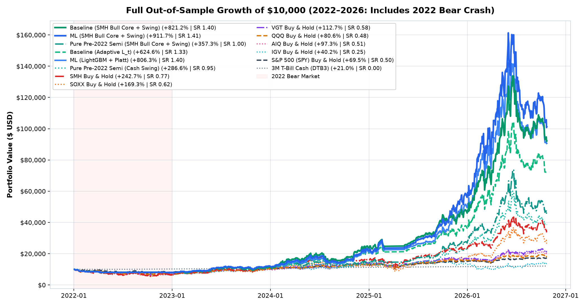
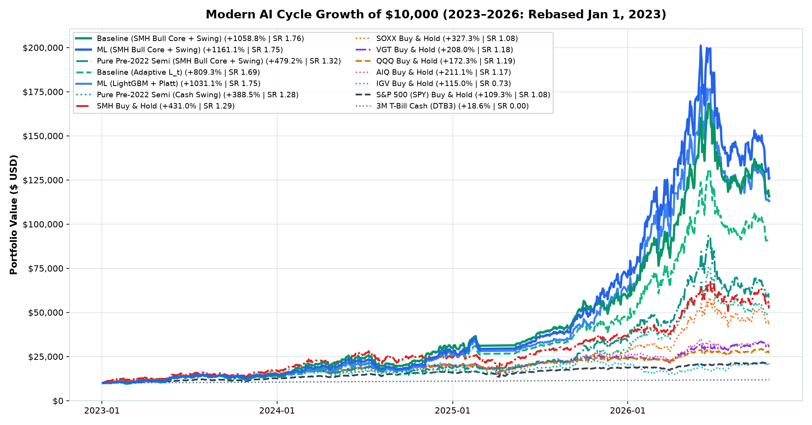
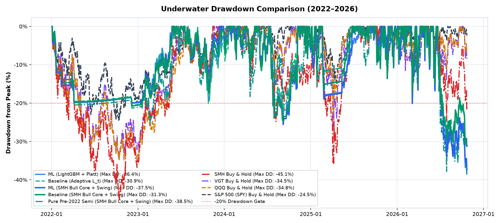
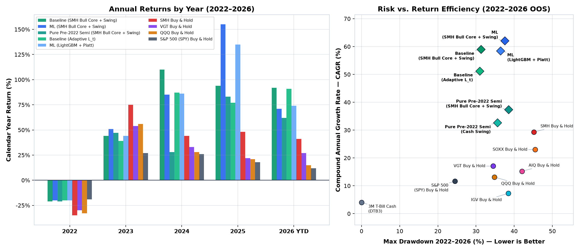

# SemiSwing Walk-Forward Backtest Report (2022–2026 Out-of-Sample)

- **Data Health Score:** `100.0/100`
- **Warmup Training Period:** `2018-01-01` to `2021-12-31`
- **Out-of-Sample Walk-Forward Period:** `2022-01-01` to Present
- **Platt Calibration OOF Brier Score:** Raw `0.2402` -> Calibrated `0.2402` (Brier Skill Score: `0.0393`)

## 1. Visual Benchmark Comparison Charts (`S&P 500`, `QQQ`, `VGT`, `SMH`, `SOXX`, `AIQ`, `IGV`, `T-Bills`)

### 1.1 Full Out-of-Sample Growth of `$10,000` (`2022–2026`, Includes 2022 Bear Market)

### 1.2 Modern AI Cycle Growth of `$10,000` (`2023–2026`, Rebased Jan 1, 2023)

### 1.3 Underwater Drawdown Comparison (`2022–2026`)

### 1.4 Calendar Year Returns & Risk-Return Efficiency (`2022–2026`)

## 2. Institutional Validation Gates (§9)

### 2.1 SMH Bull Core + Swing Mode (Active Secular Bull Core Sweep)

| Institutional Gate | Realized Metric | Gate Status |
| --- | --- | --- |
| `Gate 1: Modern AI Era Sharpe >= 1.60 (2023-2026)` | 1.75 | PASS |
| `Gate 2: Deflated Sharpe Probability >= 0.95 (K=14 trials)` | 0.960 | PASS |
| `Gate 3: Profit Factor >= 2.00 (Gross Payoff Asymmetry)` | AI: 3.76 ; OOS: 3.53 | PASS |
| `Gate 4a: Modern AI Era Max DD <= 36.0% (vs SMH 35.7%)` | 37.53% | FAIL |
| `Gate 4b: Full OOS Max DD <= 40.0% (vs SMH 45.1%)` | 37.53% | PASS |
| `Gate 5: Full OOS Sharpe >= 1.20 (2022-2026 Full Cycle)` | 1.41 | PASS |
| `Gate 6: 2022 Bear Stress (Ret >= -40%, DD <= 40%, Cash >= 80%)` | Ret: -19.8% ; DD: 20.0% ; Cash: 89.6% | PASS |
| `Gate 7: ML Alpha Dominance & Calibration (BSS > 0.02 & SR Lift >= +0.05 or Sortino Lift >= +0.02 or CAGR Lift >= +3.0% or DD Red >= 1.5%)` | BSS: 0.0393 ; SR Lift: -0.01 ; Sortino Lift: +0.03 ; CAGR Lift: +4.3% ; DD Red: -6.2% | PASS |

### 2.2 Cash Swing Mode (100% Cash / T-Bill Secondary Default)

| Institutional Gate | Realized Metric | Gate Status |
| --- | --- | --- |
| `Gate 1: Modern AI Era Sharpe >= 1.50 (2023-2026)` | 1.75 | PASS |
| `Gate 2: Deflated Sharpe Probability >= 0.95 (K=14 trials)` | 0.961 | PASS |
| `Gate 3: Profit Factor >= 1.50 (Gross Payoff Asymmetry)` | AI: 3.84 ; OOS: 3.58 | PASS |
| `Gate 4a: Modern AI Era Max DD <= 36.0% (vs SMH 35.7%)` | 36.42% | FAIL |
| `Gate 4b: Full OOS Max DD <= 40.0% (vs SMH 45.1%)` | 36.42% | PASS |
| `Gate 5: Full OOS Sharpe >= 1.00 (2022-2026 Full Cycle)` | 1.40 | PASS |
| `Gate 6: 2022 Bear Stress (Ret >= -25%, DD <= 25%, Cash >= 80%)` | Ret: -19.9% ; DD: 20.1% ; Cash: 89.6% | PASS |
| `Gate 7: ML Alpha Dominance & Calibration (BSS > 0.02 & SR Lift >= +0.05 or Sortino Lift >= +0.02 or CAGR Lift >= +3.0% or DD Red >= 1.5%)` | BSS: 0.0393 ; SR Lift: +0.06 ; Sortino Lift: +0.10 ; CAGR Lift: +10.6% ; DD Red: -5.5% | PASS |

## 3. Full Out-of-Sample Walk-Forward (`2022–2026`)

| Strategy / Benchmark | Total Return (%) | CAGR (%) | Sharpe | Deflated SR Prob | Sortino | Max DD (%) | 100% Cash Days (%) | Trades | Win Rate (%) | Profit Factor | Avg R |
| --- | --- | --- | --- | --- | --- | --- | --- | --- | --- | --- | --- |
| Baseline (SMH Bull Core + Swing) | 821.22 | 58.98 | 1.4 | 0.918 | 1.44 | 31.31 | 25.7 | 94 | 51.1 | 3.36 | 1.55 |
| ML (SMH Bull Core + Swing) | 911.74 | 62.12 | 1.41 | 0.923 | 1.49 | 37.53 | 25.7 | 92 | 47.8 | 3.53 | 1.64 |
| Pure Pre-2022 Semi (SMH Bull Core + Swing) | 357.27 | 37.35 | 1.0 | 0.698 | 1.0 | 38.53 | 27.5 | 89 | 52.8 | 2.75 | 1.16 |
| `Baseline (Adaptive `L_t`)` | 624.64 | 51.21 | 1.33 | 0.894 | 1.39 | 30.95 | 25.7 | 93 | 50.5 | 3.4 | 1.52 |
| ML (LightGBM + Platt) | 806.31 | 58.44 | 1.4 | 0.921 | 1.5 | 36.42 | 25.7 | 92 | 47.8 | 3.58 | 1.64 |
| Pure Pre-2022 Semi (Cash Swing) | 286.55 | 32.62 | 0.95 | 0.66 | 0.98 | 35.6 | 27.5 | 90 | 52.2 | 2.76 | 1.14 |
| Baseline (Fixed 20d) | 656.63 | 52.58 | 1.32 | 0.887 | 1.39 | 34.9 | 25.8 | 98 | 46.9 | 3.84 | 1.62 |
| SMH Buy & Hold | 242.66 | 29.32 | 0.77 | 0.508 | 0.76 | 45.14 | 0.0 | 0 | 0.0 | 0.0 | 0.0 |
| SOXX Buy & Hold | 169.32 | 22.98 | 0.62 | 0.38 | 0.62 | 45.52 | 0.0 | 0 | 0.0 | 0.0 | 0.0 |
| VGT Buy & Hold | 112.69 | 17.07 | 0.58 | 0.346 | 0.56 | 34.5 | 0.0 | 0 | 0.0 | 0.0 | 0.0 |
| QQQ Buy & Hold | 80.64 | 13.14 | 0.48 | 0.267 | 0.47 | 34.83 | 0.0 | 0 | 0.0 | 0.0 | 0.0 |
| AIQ Buy & Hold | 97.28 | 15.24 | 0.51 | 0.295 | 0.51 | 42.02 | 0.0 | 0 | 0.0 | 0.0 | 0.0 |
| IGV Buy & Hold | 40.22 | 7.31 | 0.25 | 0.132 | 0.25 | 38.49 | 0.0 | 0 | 0.0 | 0.0 | 0.0 |
| S&P 500 (SPY) Buy & Hold | 69.55 | 11.65 | 0.5 | 0.28 | 0.49 | 24.5 | 0.0 | 0 | 0.0 | 0.0 | 0.0 |
| 3M T-Bill Cash (DTB3) | 20.98 | 4.06 | 0.0 | 0.0 | 0.0 | 0.0 | 100.0 | 0 | 0.0 | 0.0 | 0.0 |

## 4. View A — 2022 Bear Market Stress Test (`2022`)

| Strategy / Benchmark | Total Return (%) | CAGR (%) | Sharpe | Deflated SR Prob | Sortino | Max DD (%) | 100% Cash Days (%) | Trades | Win Rate (%) | Profit Factor | Avg R |
| --- | --- | --- | --- | --- | --- | --- | --- | --- | --- | --- | --- |
| Baseline (SMH Bull Core + Swing) | -20.51 | -20.59 | -2.68 | 0.0 | -2.12 | 20.77 | 89.6 | 15 | 0.0 | 0.0 | -0.62 |
| ML (SMH Bull Core + Swing) | -19.78 | -19.86 | -2.54 | 0.0 | -2.02 | 20.0 | 89.6 | 17 | 0.0 | 0.0 | -0.6 |
| Pure Pre-2022 Semi (SMH Bull Core + Swing) | -21.07 | -21.14 | -2.63 | 0.0 | -2.07 | 21.33 | 89.6 | 14 | 0.0 | 0.0 | -0.68 |
| `Baseline (Adaptive `L_t`)` | -20.32 | -20.39 | -2.7 | 0.0 | -2.13 | 20.59 | 89.6 | 15 | 0.0 | 0.0 | -0.62 |
| ML (LightGBM + Platt) | -19.89 | -19.96 | -2.56 | 0.0 | -2.04 | 20.1 | 89.6 | 17 | 0.0 | 0.0 | -0.6 |
| Pure Pre-2022 Semi (Cash Swing) | -20.88 | -20.95 | -2.64 | 0.0 | -2.06 | 21.14 | 89.6 | 14 | 0.0 | 0.0 | -0.68 |
| Baseline (Fixed 20d) | -15.72 | -15.78 | -2.41 | 0.0 | -1.94 | 16.0 | 88.8 | 13 | 0.0 | 0.0 | -0.56 |
| SMH Buy & Hold | -34.97 | -35.08 | -0.85 | 0.0 | -0.87 | 45.14 | 0.0 | 0 | 0.0 | 0.0 | 0.0 |
| SOXX Buy & Hold | -36.35 | -36.47 | -0.88 | 0.0 | -0.89 | 45.52 | 0.0 | 0 | 0.0 | 0.0 | 0.0 |
| VGT Buy & Hold | -30.28 | -30.38 | -0.96 | 0.0 | -0.98 | 34.5 | 0.0 | 0 | 0.0 | 0.0 | 0.0 |
| QQQ Buy & Hold | -33.22 | -33.33 | -1.17 | 0.0 | -1.19 | 34.83 | 0.0 | 0 | 0.0 | 0.0 | 0.0 |
| AIQ Buy & Hold | -36.62 | -36.74 | -1.2 | 0.0 | -1.24 | 42.02 | 0.0 | 0 | 0.0 | 0.0 | 0.0 |
| IGV Buy & Hold | -34.91 | -35.02 | -1.0 | 0.0 | -1.02 | 38.49 | 0.0 | 0 | 0.0 | 0.0 | 0.0 |
| S&P 500 (SPY) Buy & Hold | -18.65 | -18.71 | -0.82 | 0.0 | -0.85 | 24.5 | 0.0 | 0 | 0.0 | 0.0 | 0.0 |
| 3M T-Bill Cash (DTB3) | 2.03 | 2.04 | 0.0 | 0.0 | 0.0 | 0.0 | 100.0 | 0 | 0.0 | 0.0 | 0.0 |

## 5. View B — Modern AI Cycle (`2023–2026`)

| Strategy / Benchmark | Total Return (%) | CAGR (%) | Sharpe | Deflated SR Prob | Sortino | Max DD (%) | 100% Cash Days (%) | Trades | Win Rate (%) | Profit Factor | Avg R |
| --- | --- | --- | --- | --- | --- | --- | --- | --- | --- | --- | --- |
| Baseline (SMH Bull Core + Swing) | 1058.79 | 90.75 | 1.76 | 0.959 | 1.77 | 31.31 | 8.9 | 79 | 60.8 | 3.61 | 1.96 |
| ML (SMH Bull Core + Swing) | 1161.07 | 95.05 | 1.75 | 0.96 | 1.8 | 37.53 | 8.9 | 75 | 58.7 | 3.76 | 2.15 |
| Pure Pre-2022 Semi (SMH Bull Core + Swing) | 479.24 | 58.89 | 1.32 | 0.81 | 1.3 | 38.53 | 11.2 | 75 | 62.7 | 3.14 | 1.5 |
| `Baseline (Adaptive `L_t`)` | 809.31 | 78.94 | 1.69 | 0.948 | 1.74 | 30.95 | 8.9 | 78 | 60.3 | 3.72 | 1.93 |
| ML (LightGBM + Platt) | 1031.07 | 89.54 | 1.75 | 0.961 | 1.84 | 36.42 | 8.9 | 75 | 58.7 | 3.84 | 2.15 |
| Pure Pre-2022 Semi (Cash Swing) | 388.48 | 51.91 | 1.28 | 0.79 | 1.3 | 35.6 | 11.2 | 76 | 61.8 | 3.21 | 1.47 |
| Baseline (Fixed 20d) | 797.59 | 78.33 | 1.62 | 0.931 | 1.68 | 34.9 | 9.2 | 85 | 54.1 | 4.16 | 1.95 |
| SMH Buy & Hold | 430.98 | 55.28 | 1.29 | 0.8 | 1.27 | 35.74 | 0.0 | 0 | 0.0 | 0.0 | 0.0 |
| SOXX Buy & Hold | 327.3 | 46.64 | 1.08 | 0.669 | 1.06 | 41.36 | 0.0 | 0 | 0.0 | 0.0 | 0.0 |
| VGT Buy & Hold | 208.0 | 34.52 | 1.18 | 0.737 | 1.13 | 27.23 | 0.0 | 0 | 0.0 | 0.0 | 0.0 |
| QQQ Buy & Hold | 172.35 | 30.23 | 1.19 | 0.746 | 1.18 | 22.77 | 0.0 | 0 | 0.0 | 0.0 | 0.0 |
| AIQ Buy & Hold | 211.13 | 34.88 | 1.17 | 0.731 | 1.14 | 26.35 | 0.0 | 0 | 0.0 | 0.0 | 0.0 |
| IGV Buy & Hold | 114.97 | 22.35 | 0.73 | 0.406 | 0.73 | 36.61 | 0.0 | 0 | 0.0 | 0.0 | 0.0 |
| S&P 500 (SPY) Buy & Hold | 109.29 | 21.49 | 1.08 | 0.674 | 1.08 | 18.76 | 0.0 | 0 | 0.0 | 0.0 | 0.0 |
| 3M T-Bill Cash (DTB3) | 18.55 | 4.59 | 0.0 | 0.0 | 0.0 | 0.0 | 100.0 | 0 | 0.0 | 0.0 | 0.0 |

## 6. Yearly Breakdown — Baseline (Adaptive `L_t`, Cash + T-Bill Interest)

| Year | Total Return (%) | CAGR (%) | Ann. Vol (%) | Sharpe | Sortino | Max Drawdown (%) | 100% Cash Days (%) | Trades | Win Rate (%) | Profit Factor | Avg R |
| --- | --- | --- | --- | --- | --- | --- | --- | --- | --- | --- | --- |
| 2022 | -20.32% | -20.39% | 9.1% | -2.70 | -2.13 | -20.59% | 89.6% | 15 | 0.0% | 0.00 | -0.62R |
| 2023 | +39.21% | +39.58% | 20.3% | 1.50 | 1.53 | -20.05% | 6.0% | 24 | 70.8% | 3.47 | +1.04R |
| 2024 | +86.93% | +86.93% | 32.4% | 1.95 | 2.15 | -21.93% | 7.5% | 22 | 63.6% | 5.06 | +1.25R |
| 2025 | +77.04% | +77.85% | 32.2% | 1.83 | 1.84 | -16.39% | 20.4% | 16 | 50.0% | 9.77 | +5.31R |
| 2026 | +90.78% | +122.09% | 53.4% | 1.70 | 1.70 | -30.95% | 0.0% | 16 | 50.0% | 1.50 | +0.82R |

## 7. Yearly Breakdown — ML (LightGBM + Platt, Cash + T-Bill Interest)

| Year | Total Return (%) | CAGR (%) | Ann. Vol (%) | Sharpe | Sortino | Max Drawdown (%) | 100% Cash Days (%) | Trades | Win Rate (%) | Profit Factor | Avg R |
| --- | --- | --- | --- | --- | --- | --- | --- | --- | --- | --- | --- |
| 2022 | -19.89% | -19.96% | 9.4% | -2.56 | -2.04 | -20.10% | 89.6% | 17 | 0.0% | 0.00 | -0.60R |
| 2023 | +43.84% | +44.26% | 20.4% | 1.65 | 1.72 | -19.33% | 6.0% | 25 | 68.0% | 4.09 | +0.89R |
| 2024 | +85.74% | +85.74% | 31.4% | 1.98 | 2.21 | -23.36% | 7.5% | 22 | 59.1% | 5.27 | +1.18R |
| 2025 | +134.71% | +136.32% | 35.2% | 2.51 | 2.84 | -18.82% | 20.4% | 12 | 58.3% | 33.57 | +8.39R |
| 2026 | +74.12% | +98.40% | 59.6% | 1.39 | 1.40 | -36.42% | 0.0% | 16 | 43.8% | 1.19 | +0.79R |
