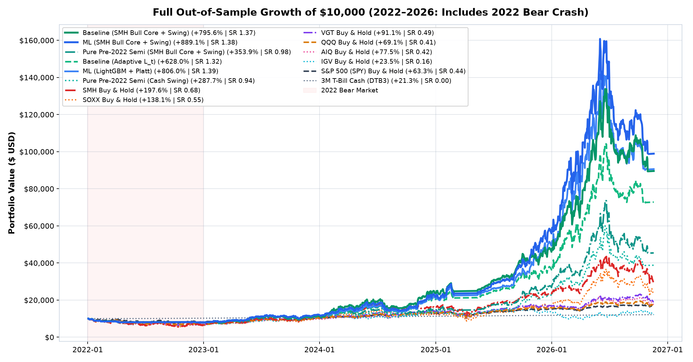
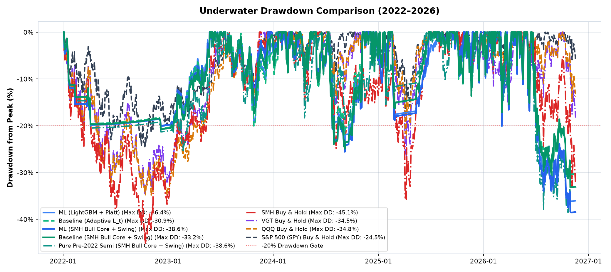
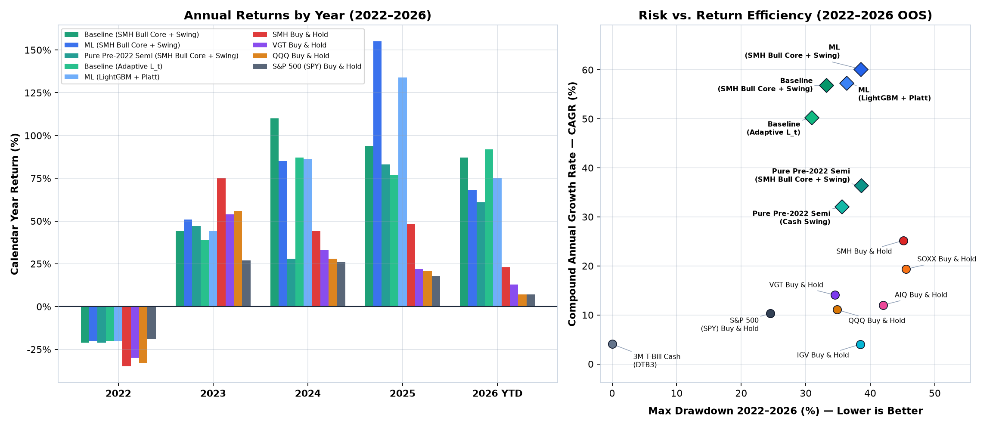

# SemiSwing Walk-Forward Backtest Report (2022–2026 Out-of-Sample)

- **Data Health Score:** `100.0/100`
- **Warmup Training Period:** `2018-01-01` to `2021-12-31`
- **Out-of-Sample Walk-Forward Period:** `2022-01-01` to Present
- **Platt Calibration OOF Brier Score:** Raw `0.2402` -> Calibrated `0.2402` (Brier Skill Score: `0.0392`)

## 1. Visual Benchmark Comparison Charts (`S&P 500`, `QQQ`, `VGT`, `SMH`, `SOXX`, `AIQ`, `IGV`, `T-Bills`)

### 1.1 Full Out-of-Sample Growth of `$10,000` (`2022–2026`, Includes 2022 Bear Market)

### 1.2 Modern AI Cycle Growth of `$10,000` (`2023–2026`, Rebased Jan 1, 2023)

### 1.3 Underwater Drawdown Comparison (`2022–2026`)

### 1.4 Calendar Year Returns & Risk-Return Efficiency (`2022–2026`)

## 2. Institutional Validation Gates (§9)

### 2.1 SMH Bull Core + Swing Mode (Active Secular Bull Core Sweep)

| Institutional Gate | Realized Metric | Gate Status |
| --- | --- | --- |
| `Gate 1: Modern AI Era Sharpe >= 1.60 (2023-2026)` | 1.73 | PASS |
| `Gate 2: Deflated Sharpe Probability >= 0.95 (K=14 trials)` | 0.959 | PASS |
| `Gate 3: Profit Factor >= 2.00 (Gross Payoff Asymmetry)` | AI: 3.63 ; OOS: 3.42 | PASS |
| `Gate 4a: Modern AI Era Max DD <= 38.0% (vs SMH 40.2%)` | 38.51% | FAIL |
| `Gate 4b: Full OOS Max DD <= 40.0% (vs SMH 45.1%)` | 38.51% | PASS |
| `Gate 5: Full OOS Sharpe >= 1.20 (2022-2026 Full Cycle)` | 1.39 | PASS |
| `Gate 6: 2022 Bear Stress (Ret >= -40%, DD <= 40%, Cash >= 80%)` | Ret: -19.8% ; DD: 20.0% ; Cash: 89.6% | PASS |
| `Gate 7: ML Alpha Dominance & Calibration (BSS > 0.02 & SR Lift >= +0.05 or Sortino Lift >= +0.02 or CAGR Lift >= +3.0% or DD Red >= 1.5%)` | BSS: 0.0392 ; SR Lift: +0.02 ; Sortino Lift: +0.06 ; CAGR Lift: +5.5% ; DD Red: -5.3% | PASS |

### 2.2 Cash Swing Mode (100% Cash / T-Bill Secondary Default)

| Institutional Gate | Realized Metric | Gate Status |
| --- | --- | --- |
| `Gate 1: Modern AI Era Sharpe >= 1.50 (2023-2026)` | 1.73 | PASS |
| `Gate 2: Deflated Sharpe Probability >= 0.95 (K=14 trials)` | 0.961 | PASS |
| `Gate 3: Profit Factor >= 1.50 (Gross Payoff Asymmetry)` | AI: 3.71 ; OOS: 3.46 | PASS |
| `Gate 4a: Modern AI Era Max DD <= 38.0% (vs SMH 40.2%)` | 36.34% | PASS |
| `Gate 4b: Full OOS Max DD <= 40.0% (vs SMH 45.1%)` | 36.34% | PASS |
| `Gate 5: Full OOS Sharpe >= 1.00 (2022-2026 Full Cycle)` | 1.39 | PASS |
| `Gate 6: 2022 Bear Stress (Ret >= -25%, DD <= 25%, Cash >= 80%)` | Ret: -19.9% ; DD: 20.1% ; Cash: 89.6% | PASS |
| `Gate 7: ML Alpha Dominance & Calibration (BSS > 0.02 & SR Lift >= +0.05 or Sortino Lift >= +0.02 or CAGR Lift >= +3.0% or DD Red >= 1.5%)` | BSS: 0.0392 ; SR Lift: +0.06 ; Sortino Lift: +0.10 ; CAGR Lift: +10.2% ; DD Red: -5.4% | PASS |

## 3. Full Out-of-Sample Walk-Forward (`2022–2026`)

| Strategy / Benchmark | Total Return (%) | CAGR (%) | Sharpe | Deflated SR Prob | Sortino | Max DD (%) | 100% Cash Days (%) | Trades | Win Rate (%) | Profit Factor | Avg R |
| --- | --- | --- | --- | --- | --- | --- | --- | --- | --- | --- | --- |
| Baseline (SMH Bull Core + Swing) | 796.24 | 56.78 | 1.36 | 0.909 | 1.4 | 33.17 | 27.0 | 96 | 51.0 | 3.33 | 1.51 |
| ML (SMH Bull Core + Swing) | 911.42 | 60.71 | 1.39 | 0.921 | 1.47 | 38.51 | 26.6 | 96 | 47.9 | 3.42 | 1.57 |
| Pure Pre-2022 Semi (SMH Bull Core + Swing) | 354.22 | 36.39 | 0.98 | 0.69 | 0.98 | 38.63 | 28.8 | 89 | 52.8 | 2.75 | 1.16 |
| `Baseline (Adaptive `L_t`)` | 628.5 | 50.26 | 1.32 | 0.894 | 1.38 | 30.95 | 27.0 | 95 | 50.5 | 3.37 | 1.48 |
| ML (LightGBM + Platt) | 810.96 | 57.3 | 1.39 | 0.921 | 1.49 | 36.34 | 26.6 | 95 | 47.4 | 3.46 | 1.58 |
| Pure Pre-2022 Semi (Cash Swing) | 287.93 | 32.04 | 0.94 | 0.66 | 0.97 | 35.6 | 28.8 | 90 | 52.2 | 2.76 | 1.14 |
| Baseline (Fixed 20d) | 637.44 | 50.63 | 1.29 | 0.879 | 1.35 | 34.9 | 26.6 | 103 | 45.6 | 3.5 | 1.52 |
| SMH Buy & Hold | 176.38 | 23.18 | 0.63 | 0.391 | 0.62 | 45.14 | 0.0 | 0 | 0.0 | 0.0 | 0.0 |
| SOXX Buy & Hold | 116.39 | 17.15 | 0.49 | 0.283 | 0.48 | 45.52 | 0.0 | 0 | 0.0 | 0.0 | 0.0 |
| VGT Buy & Hold | 83.34 | 13.23 | 0.45 | 0.249 | 0.43 | 34.5 | 0.0 | 0 | 0.0 | 0.0 | 0.0 |
| QQQ Buy & Hold | 62.7 | 10.49 | 0.37 | 0.199 | 0.36 | 34.83 | 0.0 | 0 | 0.0 | 0.0 | 0.0 |
| AIQ Buy & Hold | 69.67 | 11.45 | 0.39 | 0.209 | 0.38 | 42.02 | 0.0 | 0 | 0.0 | 0.0 | 0.0 |
| IGV Buy & Hold | 20.88 | 3.96 | 0.14 | 0.088 | 0.14 | 38.49 | 0.0 | 0 | 0.0 | 0.0 | 0.0 |
| S&P 500 (SPY) Buy & Hold | 59.71 | 10.08 | 0.41 | 0.222 | 0.4 | 24.5 | 0.0 | 0 | 0.0 | 0.0 | 0.0 |
| 3M T-Bill Cash (DTB3) | 21.41 | 4.06 | 0.0 | 0.0 | 0.0 | 0.0 | 100.0 | 0 | 0.0 | 0.0 | 0.0 |

## 4. View A — 2022 Bear Market Stress Test (`2022`)

| Strategy / Benchmark | Total Return (%) | CAGR (%) | Sharpe | Deflated SR Prob | Sortino | Max DD (%) | 100% Cash Days (%) | Trades | Win Rate (%) | Profit Factor | Avg R |
| --- | --- | --- | --- | --- | --- | --- | --- | --- | --- | --- | --- |
| Baseline (SMH Bull Core + Swing) | -20.51 | -20.59 | -2.68 | 0.0 | -2.12 | 20.77 | 89.6 | 15 | 0.0 | 0.0 | -0.62 |
| ML (SMH Bull Core + Swing) | -19.8 | -19.87 | -2.54 | 0.0 | -2.03 | 20.02 | 89.6 | 17 | 0.0 | 0.0 | -0.6 |
| Pure Pre-2022 Semi (SMH Bull Core + Swing) | -21.07 | -21.14 | -2.63 | 0.0 | -2.07 | 21.33 | 89.6 | 14 | 0.0 | 0.0 | -0.68 |
| `Baseline (Adaptive `L_t`)` | -20.32 | -20.39 | -2.7 | 0.0 | -2.13 | 20.59 | 89.6 | 15 | 0.0 | 0.0 | -0.62 |
| ML (LightGBM + Platt) | -19.9 | -19.97 | -2.56 | 0.0 | -2.04 | 20.12 | 89.6 | 17 | 0.0 | 0.0 | -0.6 |
| Pure Pre-2022 Semi (Cash Swing) | -20.88 | -20.95 | -2.64 | 0.0 | -2.06 | 21.14 | 89.6 | 14 | 0.0 | 0.0 | -0.68 |
| Baseline (Fixed 20d) | -15.72 | -15.78 | -2.41 | 0.0 | -1.94 | 16.0 | 88.8 | 13 | 0.0 | 0.0 | -0.56 |
| SMH Buy & Hold | -34.97 | -35.08 | -0.85 | 0.0 | -0.87 | 45.14 | 0.0 | 0 | 0.0 | 0.0 | 0.0 |
| SOXX Buy & Hold | -36.35 | -36.47 | -0.88 | 0.0 | -0.89 | 45.52 | 0.0 | 0 | 0.0 | 0.0 | 0.0 |
| VGT Buy & Hold | -30.28 | -30.38 | -0.96 | 0.0 | -0.98 | 34.5 | 0.0 | 0 | 0.0 | 0.0 | 0.0 |
| QQQ Buy & Hold | -33.22 | -33.33 | -1.17 | 0.0 | -1.19 | 34.83 | 0.0 | 0 | 0.0 | 0.0 | 0.0 |
| AIQ Buy & Hold | -36.62 | -36.74 | -1.2 | 0.0 | -1.24 | 42.02 | 0.0 | 0 | 0.0 | 0.0 | 0.0 |
| IGV Buy & Hold | -34.91 | -35.02 | -1.0 | 0.0 | -1.02 | 38.49 | 0.0 | 0 | 0.0 | 0.0 | 0.0 |
| S&P 500 (SPY) Buy & Hold | -18.65 | -18.71 | -0.82 | 0.0 | -0.85 | 24.5 | 0.0 | 0 | 0.0 | 0.0 | 0.0 |
| 3M T-Bill Cash (DTB3) | 2.03 | 2.04 | 0.0 | 0.0 | 0.0 | 0.0 | 100.0 | 0 | 0.0 | 0.0 | 0.0 |

## 5. View B — Modern AI Cycle (`2023–2026`)

| Strategy / Benchmark | Total Return (%) | CAGR (%) | Sharpe | Deflated SR Prob | Sortino | Max DD (%) | 100% Cash Days (%) | Trades | Win Rate (%) | Profit Factor | Avg R |
| --- | --- | --- | --- | --- | --- | --- | --- | --- | --- | --- | --- |
| Baseline (SMH Bull Core + Swing) | 1027.36 | 86.67 | 1.71 | 0.954 | 1.72 | 33.17 | 10.9 | 81 | 60.5 | 3.58 | 1.91 |
| ML (SMH Bull Core + Swing) | 1160.91 | 92.14 | 1.73 | 0.959 | 1.78 | 38.51 | 10.4 | 79 | 58.2 | 3.63 | 2.04 |
| Pure Pre-2022 Semi (SMH Bull Core + Swing) | 475.37 | 56.97 | 1.29 | 0.803 | 1.27 | 38.63 | 13.2 | 75 | 62.7 | 3.14 | 1.5 |
| `Baseline (Adaptive `L_t`)` | 814.16 | 76.86 | 1.67 | 0.948 | 1.72 | 30.95 | 10.9 | 80 | 60.0 | 3.68 | 1.88 |
| ML (LightGBM + Platt) | 1037.1 | 87.09 | 1.73 | 0.961 | 1.82 | 36.34 | 10.4 | 78 | 57.7 | 3.71 | 2.06 |
| Pure Pre-2022 Semi (Cash Swing) | 390.22 | 50.62 | 1.26 | 0.79 | 1.28 | 35.6 | 13.2 | 76 | 61.8 | 3.21 | 1.47 |
| Baseline (Fixed 20d) | 774.82 | 74.87 | 1.58 | 0.926 | 1.64 | 34.9 | 10.6 | 90 | 52.2 | 3.77 | 1.82 |
| SMH Buy & Hold | 328.27 | 45.47 | 1.06 | 0.666 | 1.04 | 40.19 | 0.0 | 0 | 0.0 | 0.0 | 0.0 |
| SOXX Buy & Hold | 243.33 | 37.42 | 0.88 | 0.527 | 0.85 | 43.44 | 0.0 | 0 | 0.0 | 0.0 | 0.0 |
| VGT Buy & Hold | 165.5 | 28.61 | 0.96 | 0.586 | 0.9 | 27.23 | 0.0 | 0 | 0.0 | 0.0 | 0.0 |
| QQQ Buy & Hold | 145.29 | 26.01 | 0.99 | 0.614 | 0.96 | 22.77 | 0.0 | 0 | 0.0 | 0.0 | 0.0 |
| AIQ Buy & Hold | 167.59 | 28.87 | 0.96 | 0.588 | 0.92 | 27.26 | 0.0 | 0 | 0.0 | 0.0 | 0.0 |
| IGV Buy & Hold | 85.32 | 17.23 | 0.57 | 0.291 | 0.56 | 36.61 | 0.0 | 0 | 0.0 | 0.0 | 0.0 |
| S&P 500 (SPY) Buy & Hold | 97.14 | 19.11 | 0.92 | 0.562 | 0.91 | 18.76 | 0.0 | 0 | 0.0 | 0.0 | 0.0 |
| 3M T-Bill Cash (DTB3) | 18.97 | 4.58 | 0.0 | 0.0 | 0.0 | 0.0 | 100.0 | 0 | 0.0 | 0.0 | 0.0 |

## 6. Yearly Breakdown — Baseline (Adaptive `L_t`, Cash + T-Bill Interest)

| Year | Total Return (%) | CAGR (%) | Ann. Vol (%) | Sharpe | Sortino | Max Drawdown (%) | 100% Cash Days (%) | Trades | Win Rate (%) | Profit Factor | Avg R |
| --- | --- | --- | --- | --- | --- | --- | --- | --- | --- | --- | --- |
| 2022 | -20.32% | -20.39% | 9.1% | -2.70 | -2.13 | -20.59% | 89.6% | 15 | 0.0% | 0.00 | -0.62R |
| 2023 | +39.21% | +39.58% | 20.3% | 1.50 | 1.53 | -20.05% | 6.0% | 24 | 70.8% | 3.47 | +1.04R |
| 2024 | +86.93% | +86.93% | 32.4% | 1.95 | 2.15 | -21.93% | 7.5% | 22 | 63.6% | 5.06 | +1.25R |
| 2025 | +77.04% | +77.85% | 32.2% | 1.83 | 1.84 | -16.39% | 20.4% | 16 | 50.0% | 9.77 | +5.31R |
| 2026 | +91.79% | +106.71% | 50.8% | 1.62 | 1.62 | -30.95% | 9.7% | 18 | 50.0% | 1.48 | +0.71R |

## 7. Yearly Breakdown — ML (LightGBM + Platt, Cash + T-Bill Interest)

| Year | Total Return (%) | CAGR (%) | Ann. Vol (%) | Sharpe | Sortino | Max Drawdown (%) | 100% Cash Days (%) | Trades | Win Rate (%) | Profit Factor | Avg R |
| --- | --- | --- | --- | --- | --- | --- | --- | --- | --- | --- | --- |
| 2022 | -19.90% | -19.97% | 9.4% | -2.56 | -2.04 | -20.12% | 89.6% | 17 | 0.0% | 0.00 | -0.60R |
| 2023 | +44.18% | +44.61% | 20.5% | 1.66 | 1.73 | -19.41% | 6.0% | 25 | 68.0% | 4.09 | +0.89R |
| 2024 | +85.50% | +85.50% | 31.4% | 1.97 | 2.21 | -23.38% | 7.5% | 22 | 59.1% | 5.23 | +1.18R |
| 2025 | +134.22% | +135.82% | 35.2% | 2.51 | 2.84 | -18.76% | 20.4% | 12 | 58.3% | 33.56 | +8.39R |
| 2026 | +75.20% | +86.87% | 56.6% | 1.33 | 1.34 | -36.34% | 7.5% | 19 | 42.1% | 1.14 | +0.62R |
